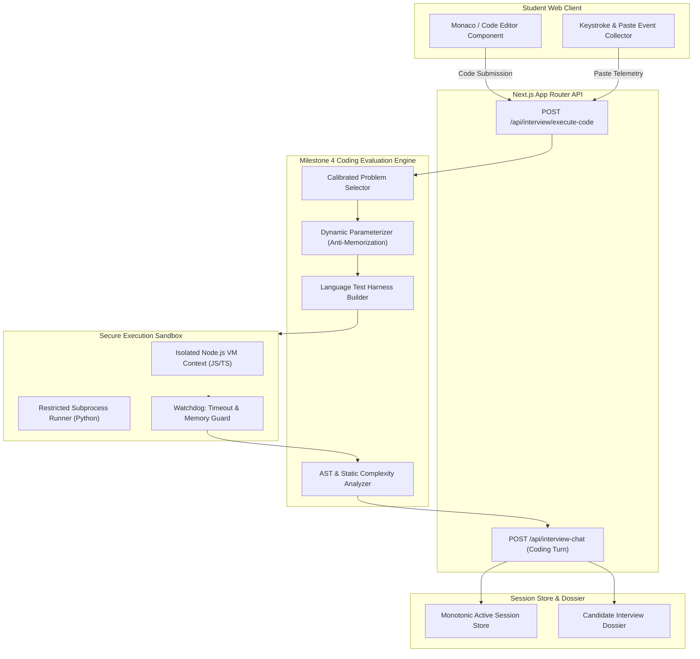

# Master Engineering Specification — Milestone 4
## Dynamic Coding & Sandbox Evaluation Engine

**Document ID:** `docs/technical_interview_milestone4_implementation_spec_v1.md`  
**Status:** SPECIFICATION GATE (Awaiting User Approval — STRICTLY UNIMPLEMENTED)  
**Author:** Principal Software Architect, Cognalyze  
**Target Deployment:** `https://cognalyze-gules.vercel.app`  

---

## 1. Executive Summary & Problem Statement

### 1.1 Objective
Milestone 4 elevates the Cognalyze Technical Interview Agent from verbal and architectural dialogue to hands-on algorithmic, data structure, and system implementation verification. 

Instead of relying solely on verbal claims or static code pasteboards, the agent must present candidates with tailored, role-calibrated coding challenges, execute candidate submissions inside a hardened, isolated sandbox, and objectively evaluate code correctness, edge-case coverage, runtime efficiency, and engineering style.

### 1.2 Anti-Cheat & Originality Mandate
Traditional technical interviews suffer from two fatal vulnerabilities:
1. **LeetCode Memorization:** Candidates recite memorized solutions to standard canonical problems without genuine problem-solving ability.
2. **LLM Ghost-Writing / Copy-Paste:** Candidates copy problem descriptions into external LLMs and paste complete solutions.

Milestone 4 introduces **dynamic problem parameterization** (altering constraints, signature types, and problem contexts) combined with **keystroke rhythm telemetry** and **AST structural evaluation** to guarantee defensible proof of candidate competence.

---

## 2. Architecture & System Flow



---

## 3. Detailed Component Specifications

### 3.1 Problem Catalog & Dynamic Parameterization Engine
The system will maintain a structured problem library across 4 competency tiers:
1. **Tier 1 (Fresher / Junior):** Basic data structures, array manipulation, string parsing, hash maps, two pointers, sliding window (e.g., LRU Cache Entry, In-Memory Rate Limiter, Valid Bracket String with Wildcards).
2. **Tier 2 (Early Career / Mid-Level):** Tree/Graph traversal, topological sort, concurrency queues, interval scheduling, prefix sums, binary search on search space (e.g., Task Dependency Scheduler, Meeting Room Capacity, Concurrent Ring Buffer).
3. **Tier 3 (Senior):** Distributed state replication, lock contention optimization, thread-safe caches with TTL, custom memory allocators, stream aggregation.
4. **Tier 4 (Staff / Lead):** Zero-copy buffer processing, Raft log compaction simulation, high-concurrency lock-free queues.

#### Anti-Memorization Parameterization:
When presenting a problem, the parameterizer dynamically mutates:
- **Identifier Nomenclature:** Variable names, function names, and domain metaphors (e.g., transforming a generic Dijkstra shortest-path problem into an airport flight delay minimizer or a microservice RPC latency router).
- **Edge Conditions:** Inverting boundary conditions (e.g., 1-indexed vs 0-indexed, ascending vs descending priorities, circular array constraints).
- **Return Contract:** Altering return types (e.g., returning indices, returning total counts, or returning transformed tuples).

### 3.2 Test Case Architecture & Two-Tier Verification
Each problem defines two distinct test suites:

```typescript
export interface CodingTestCase {
  id: string;
  category: "smoke" | "boundary" | "performance" | "stress" | "adversarial";
  input: any[];
  expected: any;
  description: string;
  isHidden: boolean; // Hidden from candidate during test runs
  timeLimitMs?: number;
  memoryLimitMb?: number;
}
```

1. **Public Smoke Tests (2–3 cases):** Displayed directly in the candidate's editor to verify basic function signatures, arguments, and expected return types.
2. **Private Evaluation Tests (5–10 cases):** Executed during formal submission to verify:
   - Empty, null, or single-element inputs.
   - Negative numbers and integer overflow boundaries.
   - Duplicate keys and collided hashes.
   - Large scale arrays ($N = 10^5$) to trigger Time Limit Exceeded (TLE) on $O(N^2)$ brute-force solutions.

### 3.3 Secure Execution Sandbox Specification

Building upon Cognalyze's existing sandbox foundations (`lib/skills/code-comprehension/execution-sandbox.ts`):

#### A. JavaScript / TypeScript Execution Runtime
- **Technology:** Node.js native `node:vm` in isolated context (`vm.createContext`).
- **Global Whitelist:** Only standard deterministic primitives: `Math`, `Date.now()`, `Array`, `Object`, `Set`, `Map`, `Number`, `String`, `Boolean`, `RegExp`, `JSON`.
- **Global Blacklist:** Complete denial of `process`, `require`, `import`, `fetch`, `global`, `eval`, `Function`, `fs`, `net`, `child_process`, `Buffer`.
- **Execution Safeguards:**
  - `timeout`: Strict wall-clock cutoff at 1,500ms per test case.
  - `breakOnSigint`: True.
  - Memory ceiling: Isolated heap budget bounded by V8 isolate limits.

#### B. Python Execution Runtime
- **Technology:** Ephemeral child process executing an autogenerated test harness script (`app/api/simulation/execute-code`).
- **Isolation Directives:**
  - Spawned with `env: {}` (clean environment, zero credential leakage).
  - Executed under non-root unprivileged process context.
  - Resource limits (`ulimit -t 2` for CPU seconds, `ulimit -v 131072` for 128MB virtual memory).
  - Timeout enforcement: `setTimeout` killer at 2,500ms wall-clock duration.

### 3.4 AST & Static Code Complexity Analysis
Following test execution, the engine runs static analysis on the submitted code string:
1. **Time & Space Complexity Classification:**
   - Detects nested loop depth (single loop $\to O(N)$, nested loops $\to O(N^2)$, triple nested $\to O(N^3)$).
   - Detects logarithmic patterns (binary search division loops $\to O(\log N)$).
   - Identifies auxiliary space allocations (allocating new arrays/matrices $\to O(N)$ extra space vs in-place modification $\to O(1)$).
2. **Code Quality & Smells:**
   - Detects hardcoded return values designed to pass specific public tests.
   - Flags excessive global state or undeclared variables.
   - Assesses naming conventions and code modularity.
3. **Plagiarism & Paste Telemetry:**
   - Keystroke vs paste ratio: If a 50-line solution appears in < 2 seconds via a single paste event, the submission is tagged `suspicious_paste_detected: true`.

---

## 4. State Machine & Interview Lifecycle Integration

### 4.1 Plan DAG Integration
Milestone 4 connects directly into the 5-stage DAG introduced in Milestone 3:
- In `generateStructuredInterviewPlan`:
  - When the interview track is `technical_algorithms` or `full_stack_backend`, Stage 3 or 4 instantiates a `PlannedInterviewQuestion` with `category: "live_coding"`.
  - The `promptStem` provides the conversational framing, while `codingChallengeId` points to the sandbox challenge.

### 4.2 Interactive Hinting & Guidance Engine
Candidates struggling on a coding challenge may request assistance:
- **Hint Level 1 (Algorithmic Nudge):** Points out the optimal data structure (e.g., *"Think about using a two-pointer approach from both ends of the array rather than a nested loop."*).
- **Hint Level 2 (Edge Case Clarification):** Highlights the failing boundary (e.g., *"What happens if the target value does not exist in the array?"*).
- **Hint Tracking:** Every hint is tracked in `sessionState.assistanceCount` and mathematically docked in the final rubric score (e.g., max score capped at 85/100 for 1 hint, 70/100 for 2 hints).

---

## 5. API Contracts & Interfaces

### 5.1 Sandbox Execution Endpoint (`POST /api/interview/execute-code`)

**Request Payload:**
```typescript
export interface CodeExecutionRequest {
  sessionId: string;
  challengeId: string;
  language: "typescript" | "javascript" | "python";
  code: string;
  isFormalSubmission: boolean; // false = run smoke tests only; true = evaluate hidden tests
  telemetry?: {
    pasteCount: number;
    keystrokeCount: number;
    durationSeconds: number;
  };
}
```

**Response Payload:**
```typescript
export interface CodeExecutionResponse {
  success: boolean;
  score: number; // 0 - 100
  totalTests: number;
  passedTests: number;
  runtimeMs: number;
  memoryMb: number;
  estimatedComplexity: {
    time: "O(1)" | "O(log N)" | "O(N)" | "O(N log N)" | "O(N^2)" | "O(2^N)";
    space: "O(1)" | "O(N)" | "O(N^2)";
  };
  results: {
    testId: string;
    status: "passed" | "failed" | "time_limit_exceeded" | "runtime_error";
    durationMs: number;
    description: string;
    actualOutput?: any;
    expectedOutput?: any; // Redacted for hidden tests
    errorMessage?: string;
  }[];
  feedback: {
    codeSmells: string[];
    securityFlags: string[];
    interviewerComments: string;
  };
}
```

---

## 6. Acceptance Criteria & Test Verification Plan

Before Milestone 4 can be declared complete, the following 10 master acceptance tests must pass:

- **TC-M4-1 (Smoke & Hidden Separation):** Public smoke tests return full input/output diffs; hidden tests execute but redact expected answers on failure.
- **TC-M4-2 (Timeout Termination):** An infinite `while(true)` loop is cleanly aborted within 1,500ms with status `time_limit_exceeded` without crashing the parent Node.js process.
- **TC-M4-3 (Sandbox Isolation):** Attempts to access `process.env`, `require('fs')`, or make network requests throw execution security errors.
- **TC-M4-4 (Optimal Complexity Credit):** An $O(N)$ solution passes all large stress tests; an $O(N^2)$ brute-force solution fails on performance stress tests.
- **TC-M4-5 (AST Static Verification):** Detects hardcoded test lookup maps (e.g., `if (input === [1, 2]) return 3;`) and flags fraudulent solutions.
- **TC-M4-6 (Assistance Calibration):** Hint requests reduce final coding rubric scores monotonically and record `is_assisted: true`.
- **TC-M4-7 (Monotonic Persistence):** Code submissions and execution reports are persistently recorded in `session.turns[i].codeExecutionReport` with strict state versioning.
- **TC-M4-8 (Multi-Language Parity):** TypeScript, JavaScript, and Python solutions produce identical scoring evaluations on isomorphic test suites.
- **TC-M4-9 (Telemetry Auditing):** Submissions exceeding paste thresholds are flagged for human recruiter audit in the final interview report.
- **TC-M4-10 (Conduct Machine Co-existence):** Candidate misconduct or verbal hostility during a coding turn continues to trigger the Milestone 2 Conduct State Machine.

---

## 7. Execution Boundary & Gate

**STRICT DIRECTIVE:**  
No code for Milestone 4 will be created or edited until this specification has been formally reviewed and approved by the user.

