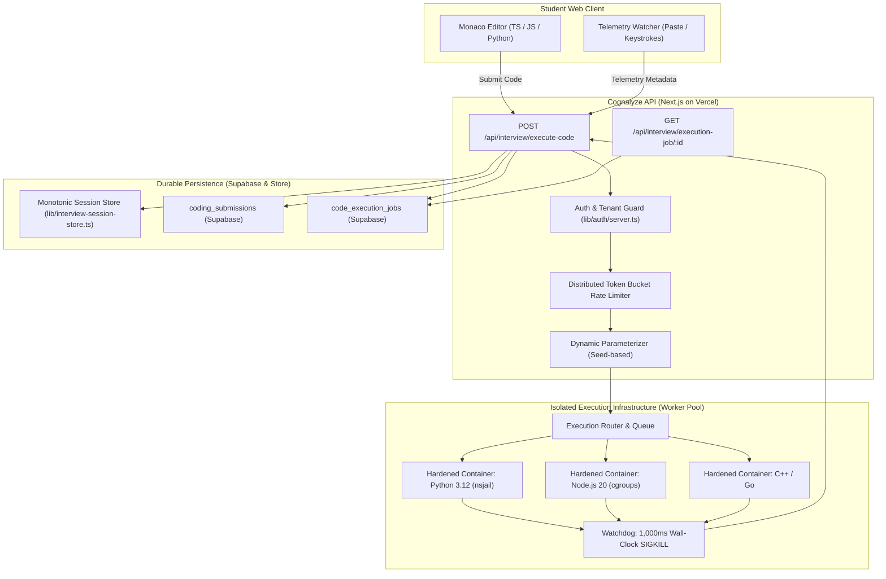
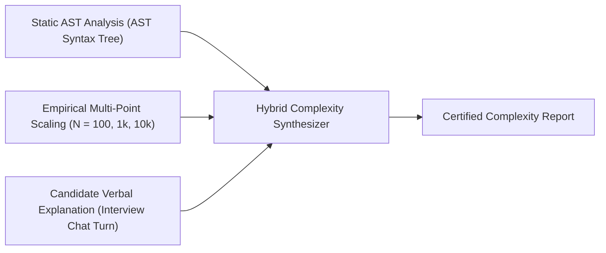

# Master Engineering Specification — Milestone 4 (Version 2)
## Decoupled Dynamic Coding & Sandbox Evaluation Engine

**Document ID:** `docs/technical_interview_milestone4_implementation_spec_v2.md`  
**Supercedes:** `docs/technical_interview_milestone4_implementation_spec_v1.md`  
**Status:** SPECIFICATION GATE — Awaiting User Approval (STRICTLY UNIMPLEMENTED)  
**Author:** Principal Software Architect & Security Specialist, Cognalyze  
**Target Deployment:** `https://cognalyze-gules.vercel.app` (Verified Local Target)  

---

## 1. Executive Architecture Summary

Milestone 4 introduces live, adaptive coding evaluation into the Cognalyze Technical Interview Agent. Instead of treating code execution as a generic web IDE feature, Milestone 4 embeds hands-on implementation challenges directly into the 5-stage interview plan DAG.

### Core Architectural Pillars:
1. **Decoupled Sandbox Isolation:** Untrusted candidate code is never executed inside the Next.js serverless process. Production execution is dispatched to a containerized sandbox service (e.g., self-hosted Judge0 CE or Piston on dedicated worker infrastructure) with Linux cgroups, seccomp, disabled network, and stripped environments.
2. **Deterministic Seed Parameterization:** Leverages Cognalyze's 89 existing canonical DSA problems (`lib/skills/dsa-canonical-problems.ts`) while applying session-seeded AST/token transformations (variable re-naming, boundary shifts, domain metaphors) to neutralize LeetCode memorization.
3. **Two-Tier Test Integrity:** Clear physical and logical separation between public smoke tests (signature verification) and private evaluation test suites (stress testing at $N = 10^5$, edge cases, boundary values).
4. **Hybrid Complexity Verification:** Replaces speculative static Big-O claims with a 3-way evaluation: AST structural analysis + empirical multi-point runtime measurement ($N_1=100, N_2=1,000, N_3=10,000$) + verbal interview explanation.
5. **Ethical Telemetry & Privacy:** Keystroke dynamics and paste frequencies are captured strictly as advisory signals for post-interview recruiter auditing; no clipboard contents are read, and accessibility tools are protected against false accusations.

---

## 2. Existing Repository Capability Inventory

| Capability | Workspace Location | Production Readiness for M4 | Integration Strategy |
| :--- | :--- | :--- | :--- |
| **DSA Problem Catalog** | `lib/skills/dsa-canonical-problems.ts` | **High (89 Problems)** | Directly reusable; inject parameterizer to alter variable names and boundary values |
| **Interview DAG Plan** | `lib/interview/interview-planner.ts` | **High (5 Stages)** | Inject Stage 3/4 `coding_challenge` track with difficulty calibration |
| **Candidate Intelligence** | `lib/interview/candidate-intelligence.ts`| **High (12-Point Profile)** | Used to select algorithmic domain matching candidate's verified stack |
| **Conduct State Machine** | `lib/interview/conduct-engine.ts` | **High (M2 Verified)** | Remains active during coding turns; handles abusive comments in chat or code comments |
| **Session Persistence** | `lib/interview-session-store.ts` | **High (Monotonic Store)** | Store code submissions and execution reports in `session.turns[i].codeExecutionReport` |
| **Database Persistence** | `supabase/migrations/20261026_*.sql` | **Medium** | Add `coding_submissions` and `code_execution_jobs` tables via future migration |
| **Authentication Context**| `lib/auth/server.ts` | **High** | Protects `POST /api/interview/execute-code` with strict `candidateId` ownership check |

---

## 3. Proposed System Architecture



---

## 4. Sandbox Threat Model & Attack Surface

The execution engine treats every submitted character as potentially adversarial:

1. **Host System Takeover:** Attempting to escape the process boundary to execute system commands, compromise host infrastructure, or mount host filesystems.
2. **Credential Theft:** Attempting to read environment variables (`DATABASE_URL`, `SUPABASE_SERVICE_ROLE_KEY`, `CLERK_SECRET_KEY`, LLM API keys).
3. **Serverless Denial of Service (DoS):** Launching infinite loops (`while(true)`), fork bombs (`os.fork()`), or memory allocations (`'a' * 10**9`) to hang the serverless runtime and spike infrastructure costs.
4. **Lateral Network Movement:** Opening TCP/UDP sockets to internal AWS/Vercel metadata services (`169.254.169.254`) or initiating outbound attacks.
5. **Harness & Evaluation Tampering:** Exploiting language reflection or monkey-patching (`Array.prototype.push`, `sys.stdout.write`) to fake passing test results.
6. **Cross-Tenant Data Spying:** Reading temporary files created by previous candidate interview executions.

---

## 5. Security Enforcement Matrix

| Threat Vector | Attack Scenario | Required Enforcement Control | Enforcement Layer | Verification Acceptance Test |
| :--- | :--- | :--- | :--- | :--- |
| **SEC-01: VM Escape** | Prototype traversal (`this.constructor.constructor('return process')()`) | Execution isolated to separate container/sandbox; no host V8 sharing | Linux Container / Isolate Boundary | `TC-M4-SEC-01` |
| **SEC-02: Secret Theft** | `os.environ.get('DATABASE_URL')` | Empty environment whitelist (`env: { PATH: "/bin:/usr/bin" }`) | Container Runtime Config | `TC-M4-SEC-02` |
| **SEC-03: Infinite Loop** | `while(true) {}` or deep recursion | Hard wall-clock SIGKILL at 1,000ms per test case | OS Process Watchdog | `TC-M4-SEC-03` |
| **SEC-04: Fork Bomb** | `while(1) { fork(); }` | Max process count cap (`pids_limit: 16`, `nproc: 16`) | Linux Cgroups `pids.max` | `TC-M4-SEC-04` |
| **SEC-05: Memory Spike**| Allocating 2GB array to trigger OOM | Hard memory limit (128MB max heap) | Linux Cgroups `memory.max` | `TC-M4-SEC-05` |
| **SEC-06: File Vandalism**| `rm -rf /` or path traversal `../../` | Read-only root filesystem; isolated tmpfs per execution | Mount Namespaces / tmpfs | `TC-M4-SEC-06` |
| **SEC-07: Network Access**| Outbound connection / SSRF | Complete network isolation (`--net=none`) | Linux Network Namespace | `TC-M4-SEC-07` |
| **SEC-08: Output Spoof**| Printing fake harness markers | Out-of-band IPC serialization via dedicated file descriptor | Runner Protocol | `TC-M4-SEC-08` |
| **SEC-09: Test Sniffing**| Reading global test array | Test cases injected one-by-one; private tests kept out of process | Test Driver Protocol | `TC-M4-SEC-09` |
| **SEC-10: Tenant Leak** | Reading leftover files in `/tmp` | Fresh ephemeral working directory; deleted in `finally` block | Filesystem Cleaner | `TC-M4-SEC-10` |

---

## 6. Language Execution Architecture

### 6.1 Production Primary: Decoupled Sandbox Worker
- Cognalyze API dispatches execution jobs over TLS to an isolated worker pool running standard sandbox containers (Judge0 CE / Piston).
- **Communication Protocol:** JSON over internal HTTP/REST with mutual TLS (mTLS) or shared secret token.
- **Languages Supported:**
  - **JavaScript / TypeScript:** Node.js 20+ runtime with V8 options `--max-old-space-size=128`.
  - **Python:** Python 3.12+ runtime inside `nsjail` with unprivileged user `sandbox_user`.
  - **Go / C++:** Pre-compiled inside container with `-O2 -std=c++20`.

### 6.2 Local Development Fallback: Hardened Child Process
For local offline test suites (`tests/technical-interview-*.test.ts`):
- Executes inside a Node.js child process (`fork` or `execFile`) with:
  1. `env: { PATH: "/bin:/usr/bin" }` (Zero host environment inheritance).
  2. `timeout: 1500` (Enforced by parent process).
  3. `maxBuffer: 1024 * 512` (512KB output ceiling to prevent buffer exhaustion).
  4. Ephemeral directory created under `os.tmpdir()` and deleted unconditionally in `finally`.

---

## 7. Dynamic Problem Generation & Anti-Memorization Design

### 7.1 Deterministic Seed Parameterization
Instead of generating unverified problems on the fly with LLMs (which risks unsolvable problems or invalid test assertions), Cognalyze parameterizes validated problems from `lib/skills/dsa-canonical-problems.ts`:

$$\text{Seed} = \text{HMAC-SHA256}(\text{sessionId} + \text{problem.id}, \text{APP\_SECRET})$$

### 7.2 Parameterization Transformations:
1. **Identifier Nomenclature:** Renames function and parameter names using a domain context dictionary:
   - *Example:* `maxSubArray(nums)` $\to$ `findMaxBandwidthSegment(packets)` or `optimalFlightWindow(delays)`.
2. **Boundary Shifting:** Inverts index conventions or alters threshold offsets:
   - *Example:* Target sum $K$ shifted by a deterministic offset $\Delta$ with corresponding test cases updated by the exact same mathematical transformation.
3. **Return Type Adaptation:** Requires returning a tuple `[maxVal, startIndex, endIndex]` instead of a single scalar `maxVal`, forcing the candidate to demonstrate index tracking mechanics rather than reciting LeetCode lines.

### 7.3 Validation Invariant
Every parameterized problem instance is executed against the problem's certified reference solution (`problem.referenceSolution`) before presentation to the candidate. If the reference solution fails any transformed test case, the parameterizer immediately reverts to canonical defaults.

---

## 8. Hidden Test Protection & Two-Tier Verification

### 8.1 Physical Separation
- **Tier 1: Public Smoke Tests (2–3 cases):** Input, expected output, and candidate output are returned transparently to assist candidate debugging.
- **Tier 2: Private Evaluation Tests (5–10 cases):** Input data and expected answers are never returned in the API response. On failure, the candidate receives only the failure category:
  - `Wrong Answer on Hidden Test #4`
  - `Time Limit Exceeded on Stress Test #7 (Input Scale N = 100,000)`
  - `Memory Limit Exceeded on Boundary Test #9`

### 8.2 Safe Candidate-Facing Response Schema
```typescript
export interface SafePublicTestResult {
  testId: string;
  name: string;
  passed: boolean;
  status: "passed" | "failed" | "time_limit_exceeded" | "runtime_error";
  durationMs: number;
  input: any; // Included ONLY for public tests
  expected: any; // Included ONLY for public tests
  actual: any; // Included ONLY for public tests
  errorMessage?: string;
}

export interface SafePrivateAggregateResult {
  totalHiddenTests: number;
  passedHiddenTests: number;
  failedTestCategory?: "wrong_answer" | "time_limit_exceeded" | "memory_limit_exceeded" | "runtime_error";
  failedTestIndex?: number; // e.g. 3 (without input/output disclosure)
}
```

---

## 9. Code Evaluation & Scoring Architecture

Candidate solutions are evaluated across **5 distinct, uncollapsed evidence streams**:

1. **Functional Correctness (Weight: 35%):**
   $$\text{Score}_{\text{func}} = \left(0.4 \times \frac{\text{Public Passed}}{\text{Public Total}}\right) + \left(0.6 \times \frac{\text{Private Passed}}{\text{Private Total}}\right)$$
2. **Runtime Efficiency (Weight: 20%):**
   Evaluates whether the solution passes stress tests within performance thresholds without hitting TLE.
3. **Algorithmic Reasoning (Weight: 20%):**
   Matches observed empirical complexity against the problem's theoretical lower bound.
4. **Code Quality & Clean Architecture (Weight: 15%):**
   Evaluates variable naming, modularity, edge-case defensive guards, and absence of code smells.
5. **Engineering Judgement & Verbal Defense (Weight: 10%):**
   Evaluates the candidate's conversational explanation in the subsequent interview turn.

---

## 10. Hybrid Complexity Evaluation Model

To avoid the mathematical impossibility of definitive static Big-O proofs, Milestone 4 implements a **3-Tier Hybrid Model**:



### 10.1 Layer 1: Static AST Analysis
- Parses submission AST using `@babel/parser` (JS/TS) or standard Python AST visitors.
- Detects nested loop depth ($1 \to O(N), 2 \to O(N^2), 3 \to O(N^3)$).
- Detects recursion trees without memoization ($O(2^N)$ danger).
- Flags fraudulent hardcoded lookup tables (`if (x === [1,2]) return 3`).

### 10.2 Layer 2: Empirical Curve Fitting
- Executes the solution against 3 calibrated test vectors:
  - $T_1$ at $N_1 = 100$
  - $T_2$ at $N_2 = 1,000$
  - $T_3$ at $N_3 = 10,000$
- Calculates the scaling ratio $R = \frac{T_3}{T_2}$:
  - If $R \approx 10 \implies O(N)$ linear scaling.
  - If $R \approx 100 \implies O(N^2)$ quadratic scaling.
  - If $R \approx 1 \implies O(1)$ or $O(\log N)$ logarithmic scaling.

### 10.3 Layer 3: Conversational Defense
In the turn following code submission, the interviewer asks:
> *"I noticed your implementation achieved a linear scaling runtime. Walk me through the time and space complexity of your algorithm, and explain why a hash map was chosen over an in-place sort."*

---

## 11. Anti-Cheat, Telemetry & Privacy Design

1. **Non-Punitive Telemetry:** Telemetry captures:
   - Keystroke count
   - Paste event count
   - Average typing burst velocity
   - Focus loss (tab switch) count
2. **Zero Clipboard Inspection:** The agent **NEVER** inspects clipboard contents (respecting candidate privacy and security).
3. **Accessibility Protection:** A paste event **NEVER** causes automatic test failure or conduct scolding. If a candidate pastes a solution in a single event, the turn completes normally, but an advisory tag `advisory: "paste_burst_audit"` is attached to the recruiter dossier.
4. **Interviewer Cross-Examination:** If a candidate pastes a 50-line solution in 1 second, the AI interviewer automatically injects a targeted code probe:
   > *"Can you explain the role of line 14 where you rebalance the pointers in the while loop? What happens if that condition is false?"*

---

## 12. API Contracts & Execution Lifecycle

### 12.1 Execution Endpoint: `POST /api/interview/execute-code`

**Request:**
```typescript
export interface CodeExecutionRequest {
  sessionId: string;
  problemId: string;
  language: "typescript" | "javascript" | "python" | "cpp";
  code: string;
  mode: "run_smoke" | "formal_submit";
  telemetry?: {
    pasteCount: number;
    keystrokeCount: number;
    durationSeconds: number;
  };
}
```

**Synchronous Fast-Path Response (`mode: "run_smoke"`):**
```typescript
export interface SmokeExecutionResponse {
  success: boolean;
  mode: "run_smoke";
  executionId: string;
  durationMs: number;
  publicResults: SafePublicTestResult[];
}
```

**Formal Submission Response (`mode: "formal_submit"`):**
```typescript
export interface FormalSubmissionResponse {
  success: boolean;
  mode: "formal_submit";
  submissionId: string;
  verdict: "ACCEPTED" | "WRONG_ANSWER" | "TIME_LIMIT_EXCEEDED" | "RUNTIME_ERROR" | "COMPILATION_ERROR";
  score: number; // 0 - 100
  publicResults: SafePublicTestResult[];
  privateAggregate: SafePrivateAggregateResult;
  complexity: {
    staticEstimate: string;
    empiricalScaling: "linear" | "quadratic" | "logarithmic" | "inconclusive";
    confidence: "high" | "medium" | "low";
  };
  feedback: {
    cleanCodeNotes: string[];
    potentialEdgeCases: string[];
  };
}
```

---

## 13. Data Model & Persistence Specifications

### Proposed Supabase Schema Additions:

```sql
-- 1. Coding Submissions Table
CREATE TABLE IF NOT EXISTS public.interview_coding_submissions (
  id TEXT PRIMARY KEY DEFAULT gen_random_uuid()::TEXT,
  session_id TEXT NOT NULL REFERENCES public.interview_sessions(id) ON DELETE CASCADE,
  candidate_id TEXT NOT NULL,
  problem_id TEXT NOT NULL,
  language TEXT NOT NULL,
  submitted_code TEXT NOT NULL,
  score NUMERIC NOT NULL DEFAULT 0,
  verdict TEXT NOT NULL,
  public_tests_passed INT NOT NULL,
  public_tests_total INT NOT NULL,
  hidden_tests_passed INT NOT NULL,
  hidden_tests_total INT NOT NULL,
  runtime_ms INT NOT NULL,
  memory_mb NUMERIC NOT NULL,
  static_complexity TEXT,
  empirical_scaling TEXT,
  telemetry JSONB DEFAULT '{}'::JSONB,
  created_at TIMESTAMPTZ DEFAULT now()
);

-- RLS: Candidates view own submissions only
ALTER TABLE public.interview_coding_submissions ENABLE ROW LEVEL SECURITY;
CREATE POLICY "Candidate access own submissions"
  ON public.interview_coding_submissions FOR ALL
  USING (auth.uid()::TEXT = candidate_id)
  WITH CHECK (auth.uid()::TEXT = candidate_id);
```

---

## 14. Performance, Scalability & Stress Benchmark Definitions

### Clarification of Stress Requirement $N = 10^5$:
In Specification v2, $N = 10^5$ is defined explicitly as:
> **The input data structure size (array length or integer magnitude)** passed to a single test case to differentiate $O(N)$ and $O(N \log N)$ algorithms from $O(N^2)$ brute-force solutions.

| Metric | Target SLA | Hard Ceiling Guard |
| :--- | :--- | :--- |
| **Smoke Test Execution Latency** | $< 800\text{ ms}$ | $2,000\text{ ms}$ timeout |
| **Full Submission Evaluation (Smoke + Private)** | $< 3,500\text{ ms}$ | $10,000\text{ ms}$ timeout |
| **Single Test Case CPU Limit** | $150\text{ ms}$ | $1,000\text{ ms}$ SIGKILL |
| **Worker Memory Limit** | $64\text{ MB}$ | $128\text{ MB}$ OOM termination |
| **Concurrent Executions per Host** | 50 concurrent | Rate-limited at 5 submissions/minute per candidate |

---

## 15. Testing & Acceptance Criteria (TC-M4-1 through TC-M4-15)

- **TC-M4-1 (Smoke/Private Separation):** Smoke tests expose full inputs/outputs; private tests redact all expected values.
- **TC-M4-2 (Timeout Termination):** Infinite loop (`while(true)`) is aborted within 1,000ms with status `time_limit_exceeded`.
- **TC-M4-3 (Sandbox Isolation):** Calling `process.env` or `require('child_process')` throws security/runtime error without leaking host secrets.
- **TC-M4-4 (Optimal Complexity Credit):** $O(N)$ solution passes $N = 10^5$ stress test; $O(N^2)$ solution triggers `time_limit_exceeded`.
- **TC-M4-5 (Static Cheat Detection):** Static table mapping (`if (x === [1,2]) return 3;`) is flagged with `suspicious_lookup_table: true`.
- **TC-M4-6 (Assistance Calibration):** Hint requests reduce coding rubric score monotonically and record `is_assisted: true`.
- **TC-M4-7 (Monotonic Persistence):** Code execution reports persist in `session.turns[i].codeExecutionReport` with incremented `stateVersion`.
- **TC-M4-8 (Multi-Language Parity):** Equivalent solutions in Python, TypeScript, and C++ produce identical correctness verdicts.
- **TC-M4-9 (Non-Punitive Paste Auditing):** A bulk paste event generates an advisory recruiter flag without penalizing technical score.
- **TC-M4-10 (Conduct Machine Co-existence):** Abusive comments in code or chat trigger Milestone 2 conduct warnings.
- **TC-M4-11 (Fork Bomb Containment):** `os.fork()` inside Python container fails cleanly under process limit without affecting the worker host.
- **TC-M4-12 (Memory Limit Enforcement):** Allocating 1GB RAM triggers `memory_limit_exceeded` within 128MB ceiling.
- **TC-M4-13 (Network Isolation):** Sockets attempting outbound HTTP connections fail immediately (`ENETUNREACH`).
- **TC-M4-14 (Harness Integrity):** Monkey-patching `print` or `JSON.stringify` does not affect out-of-band IPC test evaluation.
- **TC-M4-15 (Tenant Isolation):** Concurrent executions by candidate A and candidate B run in strictly segregated environments with zero file residue.

---

## 16. Phased Implementation Roadmap

1. **Phase 4.1: Decoupled Sandbox Adapter & Test Harness**  
   Implement the sandbox client adapter connecting to the isolated execution worker pool with local fallback.
2. **Phase 4.2: Dynamic Parameterization Engine**  
   Implement seed-based identifier mutation and boundary adaptation for the 89 canonical problems.
3. **Phase 4.3: API Route & Hybrid Complexity Evaluator**  
   Implement `POST /api/interview/execute-code` with AST analysis and empirical curve fitting.
4. **Phase 4.4: Interview Plan DAG Integration & Recruiter Reporting**  
   Connect coding challenges into Stage 3/4 and render test summaries in the final interview report.

---

## 17. Execution Boundary Confirmation

**STRICT RULE:**  
No code implementation for Milestone 4 will begin until this revised specification (v2) has been reviewed and explicitly approved by the user.

