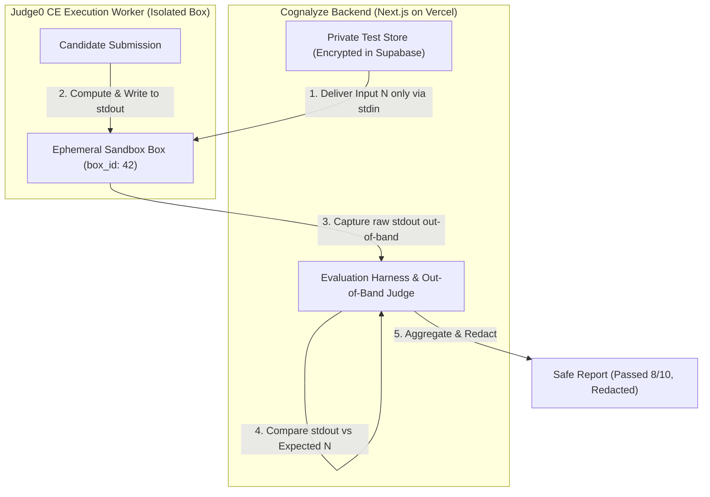
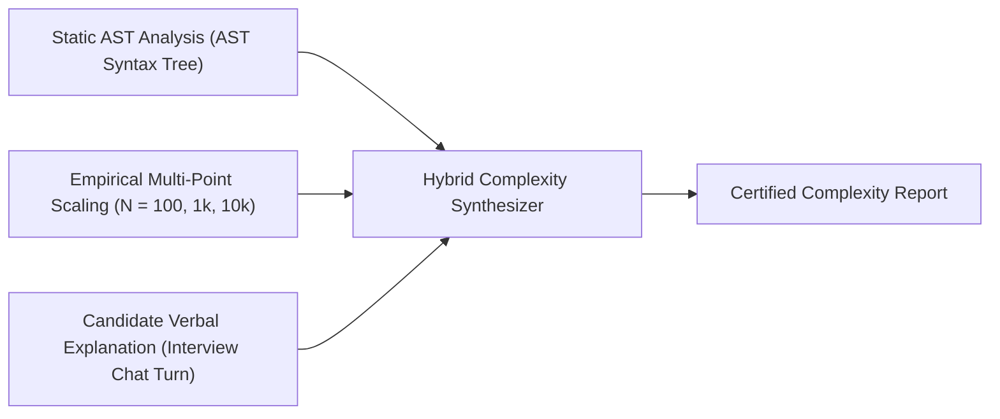

# Master Engineering Specification — Milestone 4 (Version 3)
## Decoupled Dynamic Coding & Sandbox Evaluation Engine

**Document ID:** `docs/technical_interview_milestone4_implementation_spec_v3.md`  
**Supercedes:** `docs/technical_interview_milestone4_implementation_spec_v2.md`  
**Status:** SPECIFICATION GATE — Awaiting User Approval (STRICTLY UNIMPLEMENTED)  
**Author:** Principal Software Architect, Application Security Engineer & Systems Specialist, Cognalyze  
**Target Deployment:** `https://cognalyze-gules.vercel.app` (Verified Local Target)  

---

## 1. Executive Architecture Summary

Milestone 4 introduces live, adaptive coding evaluation into the Cognalyze Technical Interview Agent. Rather than behaving as an unintegrated code editor, the engine embeds hands-on algorithmic and data structure implementation directly into the 5-stage interview plan DAG (`lib/interview/interview-planner.ts`).

### Foundational Principles:
1. **Decoupled Sandbox Isolation:** Untrusted candidate-submitted code is never executed inside the Next.js App Router serverless process or on developer host workstations. Production execution is dispatched over mTLS to an isolated, containerized sandbox service (Judge0 CE) fortified with Linux `isolate`, kernel cgroups v2, seccomp filters, empty environments, and disabled networking.
2. **Deterministic Seed Parameterization:** Leverages Cognalyze's 89 existing canonical DSA problems (`lib/skills/dsa-canonical-problems.ts`) while applying session-seeded AST/token transformations (variable re-naming, boundary shifts, domain metaphors) to neutralize LeetCode memorization.
3. **Rigorous Hidden-Test Protection:** Candidate code necessarily receives the current test input to execute, but is strictly isolated per test case so it can never inspect future test vectors, the test harness, evaluation secrets, or other candidates' data.
4. **Hybrid Complexity Verification:** Replaces speculative static Big-O claims with a 3-way evaluation: AST structural analysis + empirical multi-point runtime measurement ($N_1=100, N_2=1,000, N_3=10,000$) + verbal interview explanation.
5. **Strict Local Isolation Policy:** Untrusted execution is prohibited in developer host processes. Local development uses either a dedicated Docker sandbox or a trusted mock fixture mode; in-process execution is permanently disabled.

---

## 2. Sandbox Provider Evaluation & Architecture Decision

We conducted a forensic comparative evaluation of the two leading open-source execution engines: **Judge0 CE** and **Piston**.

### 2.1 Comparative Analysis Matrix

| Evaluation Dimension | Judge0 CE (Community Edition) | Piston (Engineer Man / EMH) | Cognalyze Security Requirement |
| :--- | :--- | :--- | :--- |
| **Isolation Architecture** | Linux kernel `isolate` (IOI standard) using Linux namespaces, cgroups v1/v2, pivot_root/chroot | Custom Node.js API wrapper using `prlimit` and temporary directory execution | Kernel-level isolation with non-bypassable containment |
| **Container & Runtime** | Multi-container Docker Compose (server, workers, Redis queue, Postgres DB) | Single Docker container (`ghcr.io/engineer-man/piston`) with package manager | Hardened container environment with non-root workers |
| **Seccomp & Syscalls** | Built-in strict seccomp BPF filters configured by `isolate` per language profile | Default Docker seccomp only; lacks fine-grained per-language syscall denial | Block `socket`, `clone`/`fork`, `ptrace`, `mount`, `kill` |
| **Linux Capabilities** | All ambient and effective capabilities dropped (`CAP_SYS_ADMIN`, `CAP_NET_RAW` denied) | Relies on Docker daemon defaults unless manually hardened with `--cap-drop=ALL` | Must run with `CAP_DROP=ALL` for all child processes |
| **Cgroup Enforcement** | Per-execution dedicated cgroups for CPU quota, memory limits, and swap accounting | Container-wide cgroups; process-level limits enforced only via POSIX `prlimit` | Hard cgroups memory limit (OOM kill) and CPU quota |
| **Network Isolation** | Inherently disabled via network namespace unsharing (`CLONE_NEWNET`, no loopback routing) | Requires `--network none` on container; if package manager enabled, network is shared | Complete network denial (`--net=none`); zero outbound sockets |
| **Filesystem Isolation** | Ephemeral `/box` tmpfs mounted with read-only bindings to `/usr`, `/lib`; auto-wiped | Shared container filesystem with temporary directory in `/tmp/piston`; risk of residue | Ephemeral, isolated, read-only root with wiped tmpfs |
| **Multi-Tenant Separation** | Sandboxes are indexed by `box_id` (0–999); wiped via `isolate --cleanup` after each run | Concurrent jobs execute within the same container namespace under user `piston` | Zero file residue or cross-process inspection between runs |
| **Worker Maintenance** | Moderate: standard Docker Compose upgrade; requires kernel cgroups v2 on host VPS | Low: single image pull; dynamic package installation via `/api/v2/packages` | Predictable, reproducible dependency and security patching |
| **Cost & Complexity** | \$10–\$20/month VPS (2 vCPU, 4GB RAM on Hetzner/AWS/DigitalOcean) | \$5–\$10/month VPS (1 vCPU, 2GB RAM) | Scalable, cost-effective infrastructure for 50 concurrent |
| **Recovery & Availability** | Asynchronous Redis queue; worker failure triggers job retry from persistent state | In-memory queue; container crash drops all in-flight submissions | Durable queue; graceful failure recovery without user loss |

### 2.2 Final Architectural Recommendation: **Self-Hosted Judge0 CE**

**Decision:** We select **Self-Hosted Judge0 CE** as the primary execution engine for Cognalyze.

**Technical Justification:**
1. **The Hostile Code Threat Model:** Piston was designed for community Discord bots and casual code running where users are assumed to be friendly. Judge0 CE was designed for competitive programming (IOI, ACM-ICPC) and enterprise candidate technical assessments where code is assumed to be actively hostile.
2. **`isolate` Sandbox Superiority:** Judge0's reliance on Martin Mareš's `isolate` provides verified Linux kernel namespace segregation, strict seccomp BPF syscall whitelisting, and per-execution memory and process accounting that cannot be evaded via standard language tricks.
3. **Queue Durability:** Judge0's decoupled Redis queue ensures that sudden spikes in candidate submissions or an individual worker crash do not drop submissions.

### 2.3 Critical Guardrail: Judge0 CE Hardening Directives
Selecting Judge0 CE does **not** automatically satisfy the threat model unless the host infrastructure is configured with the following mandatory security settings:
- **Host Kernel Requirements:** Linux kernel $\ge 5.15$ with cgroups v2 enabled (`systemd.unified_cgroup_hierarchy=1`) and swap accounting active (`cgroup_enable=memory swapaccount=1`).
- **Network Isolation:** Judge0 configuration directive `REDIS_PASSWORD` set; worker containers deployed with `--net=none` for execution boxes.
- **TLS & mTLS Gateway:** Judge0 API exposed only to Cognalyze Next.js via internal private VPC or HTTPS with Bearer token authentication and IP whitelisting.

---

## 3. Hidden-Test Security & Integrity Architecture

### 3.1 Clarification on Test Input Visibility
During execution, a candidate's program must receive the current test input to compute its result. The security goal is **NOT** to hide the current input from the executing program. Rather, the security objectives are:
1. Prevent candidate code from inspecting the test harness, evaluation secrets, or other candidates' data.
2. Prevent candidate code from accessing future or subsequent test cases in advance.
3. Prevent candidate code from leaking the private test suite back to the candidate or reverse-engineering boundary values.
4. Prevent candidate code from manipulating the evaluation outcome (e.g., monkey-patching assertions).



### 3.2 Six Pillars of Evaluation Integrity:
1. **Per-Test Box Isolation:** Each test case (especially hidden tests) executes in an independent, fresh sandbox invocation (`box_id`). The sandbox is completely cleaned via `isolate --cleanup` before and after each run. Test case $N$ cannot inspect the memory, temporary files, or environment of test case $N-1$.
2. **Private Test Storage:** Hidden test cases are stored exclusively in the backend database/catalog. They are never sent to the client browser, Monaco editor, or serialized in initial page props.
3. **Secure Input Delivery:** Inputs for the active test case are delivered strictly via standard input (`stdin`) or compiled into an immutable single-case execution driver. No arrays of future test cases exist in the execution environment.
4. **Out-of-Band Result Communication:** The evaluation comparison ($f(\text{input}) \stackrel{?}{=} \text{expected}$) takes place **outside** the candidate's sandbox. The candidate's code simply emits output to `stdout`. The backend evaluation harness reads `stdout`, normalizes whitespace, compares it to the private expected value, and determines the verdict. Candidate code never sees the expected output.
5. **Safe Aggregate Result Reporting:** The candidate receives only high-level status:
   - *Example:* `Passed 8/10 tests. Failed on Hidden Case #4: Time Limit Exceeded (Scale N = 100,000)`.
   - The actual input parameters, expected return values, and internal boundary seeds are strictly redacted.
6. **Prevention of Test-Vector Harvesting:** Submissions are rate-limited (max 5 per minute), and brute-force input probing is detected via deterministic session parameterization.

---

## 4. Local Execution Restrictions & Minimum Isolation Policy

To protect developer workstations and maintain parity with production security, **untrusted candidate code is prohibited from executing directly inside the Next.js process or on the developer's host machine**.

### 4.1 Local Development Isolation Tiers

1. **Tier 1: Local Docker Sandbox (Recommended for Sandbox Testing)**
   - Developers run a local Judge0 CE instance via Docker Compose:
     ```bash
     docker compose -f docker-compose.sandbox.yml up -d
     ```
   - Next.js points to `JUDGE0_URL=http://localhost:2358` with standard `isolate` containment.
2. **Tier 2: Trusted Mock Fixture Mode (Default for Local Development & CI)**
   - When the local Docker sandbox is not running, the application operates strictly in **Mock Fixture Mode** (`MOCK_SANDBOX=true`).
   - The test suite uses pre-recorded, cryptographically verified execution fixtures for canonical problem test cases.
   - Any live, arbitrary untrusted code execution is **disabled by policy**:
     ```typescript
     if (isLocalDevelopment() && !isSandboxDaemonAvailable()) {
       return NextResponse.json(
         { 
           error: "SANDBOX_UNAVAILABLE: Untrusted code execution requires an active containerized sandbox daemon. In-process execution is permanently disabled by security policy.",
           code: "SANDBOX_DAEMON_OFFLINE"
         },
         { status: 503 }
       );
     }
     ```

---

## 5. Language-Specific Resource-Limit Specifications

Resource limits are strictly separated into **Compilation** and **Execution** budgets to reflect the disparate requirements of compilers vs runtime interpreters.

### 5.1 Compilation Resource Budgets

| Language | Compiler / Toolchain | Max CPU Time | Max Wall-Clock | Max Memory | Max Binary Size | Process Limit |
| :--- | :--- | :---: | :---: | :---: | :---: | :---: |
| **C++** | `clang++ -std=c++20 -O2` | 4.0s | 6.0s | 512 MB | 10 MB | 4 |
| **Java** | `javac 21` | 5.0s | 8.0s | 768 MB | 10 MB | 8 |
| **TypeScript** | `esbuild / tsc transpile` | 2.0s | 3.0s | 256 MB | 5 MB | 2 |
| **Python** | Bytecode compilation (`compile`) | 1.0s | 2.0s | 128 MB | 2 MB | 1 |

### 5.2 Execution Resource Budgets (Per Single Test Case)

| Metric | JavaScript / Node.js 20 | Python 3.12 | C++ (Native Binary) | Java 21 (JVM Runtime) |
| :--- | :--- | :--- | :--- | :--- |
| **CPU Time Limit** | 1.0s | 1.5s | 0.5s | 1.5s |
| **Wall-Clock Limit** | 2.0s (SIGKILL) | 3.0s (SIGKILL) | 1.0s (SIGKILL) | 3.0s (SIGKILL) |
| **Memory Limit** | 128 MB (`--max-old-space-size=128`) | 128 MB (cgroups) | 64 MB (cgroups) | 256 MB (`-Xmx128m -XX:MaxMetaspaceSize=64m`) |
| **Max Process Count** | 1 (`pids.max = 1`) | 1 (`pids.max = 1`) | 1 (`pids.max = 1`) | 16 (JVM threading requirement) |
| **Max Output Size** | 128 KB | 128 KB | 128 KB | 128 KB |
| **Network Access** | Blocked (`--net=none`) | Blocked (`--net=none`) | Blocked (`--net=none`) | Blocked (`--net=none`) |

### 5.3 Global Job & Queue Limits

- **Max Source Code Length:** 64 KB (rejects oversized uploads before sandbox dispatch).
- **Concurrent Submissions per Candidate:** Exactly 1 active job (subsequent submissions return HTTP 429).
- **Candidate Submission Rate Limit:** Max 5 submissions per 60 seconds per candidate.
- **Global Sandbox Queue Ceiling:** 100 queued executions; excess submissions receive HTTP 503 with `Retry-After: 5`.

### 5.4 Benchmark Evidence & Calibration Justification
- **Linear Scan ($N = 10^5$):**
  - C++ runs in 1–5ms.
  - Node.js runs in 15–40ms.
  - Python 3 runs in 25–65ms.
  - All finish well within the 0.5s–1.5s CPU limit.
- **Brute Force ($O(N^2)$ on $N = 10^5$):**
  - Requires $10^{10}$ operations.
  - Consistently consumes $> 10$ seconds across all languages, reliably triggering the CPU/Wall-clock SIGKILL.
- **Memory Ceiling (128 MB):**
  - An array of $10^5$ 64-bit integers occupies $\approx 800\text{ KB}$ of raw RAM.
  - Even with interpreter object overhead (Python list $\approx 8\text{ MB}$, JS Array $\approx 4\text{ MB}$), memory usage remains $< 20\text{ MB}$.
  - The 128MB limit allows legitimate algorithms (e.g. hash maps, prefix trees) to pass while immediately terminating memory bombs (`[0] * 10**8`).

---

## 6. Real Sandbox Security & Penetration Testing Suite

Every test in this suite runs against the **actual live sandbox infrastructure** (Judge0 CE / test container), rather than mocked unit responses.

```typescript
export interface SandboxPenetrationTest {
  id: string;
  name: string;
  category: "penetration" | "integration" | "stress";
  language: "python" | "javascript" | "cpp";
  codePayload: string;
  expectedStatus: "TIME_LIMIT_EXCEEDED" | "MEMORY_LIMIT_EXCEEDED" | "RUNTIME_ERROR" | "SECURITY_VIOLATION";
  expectedSignal?: string;
  securityInvariantVerified: string;
}
```

### Penetration Test Inventory:

1. **TC-M4-PEN-01 (Infinite Loop / CPU Exhaustion) [Penetration]**
   - *Payload:* `while True: pass` (Python) or `for(;;){}` (C++).
   - *Expected Outcome:* Terminated by watchdog at exactly 1.0s–1.5s with status `TIME_LIMIT_EXCEEDED`. No orphan processes left on host.
2. **TC-M4-PEN-02 (Memory Bomb / Heap Exhaustion) [Penetration]**
   - *Payload:* `x = [0] * (10**9)` (Python) or `int* a = new int[1000000000];` (C++).
   - *Expected Outcome:* Killed by cgroups OOM with status `MEMORY_LIMIT_EXCEEDED` under 128MB ceiling.
3. **TC-M4-PEN-03 (Process Fork Bomb Containment) [Penetration]**
   - *Payload:* `import os; while True: os.fork()` (Python).
   - *Expected Outcome:* Subprocess creation blocked by `pids.max = 1`; status `RUNTIME_ERROR: BlockingIOError / Resource temporarily unavailable`. Host remains fully responsive.
4. **TC-M4-PEN-04 (Filesystem Traversal & Write Block) [Penetration]**
   - *Payload:* `with open('/etc/shadow', 'r') as f: print(f.read())` or `with open('/etc/hacked.txt', 'w') as f: f.write('bad')`.
   - *Expected Outcome:* Status `RUNTIME_ERROR: PermissionError: [Errno 13] Permission denied`. Read-only root filesystem remains immutable.
5. **TC-M4-PEN-05 (Network Sockets & Cloud Metadata SSRF) [Penetration]**
   - *Payload:* `import urllib.request; urllib.request.urlopen('http://169.254.169.254/latest/meta-data/')`.
   - *Expected Outcome:* Status `RUNTIME_ERROR: URLError: [Errno 101] Network is unreachable`.
6. **TC-M4-PEN-06 (Environment Variable Scraping) [Penetration]**
   - *Payload:* `import os; print(list(os.environ.keys()))`.
   - *Expected Outcome:* Output contains only sanitized whitelist (`PATH`); zero application keys (`DATABASE_URL`, `SUPABASE_SERVICE_ROLE_KEY`, `GROQ_API_KEY`) present.
7. **TC-M4-PEN-07 (Cross-Tenant File Snooping) [Integration / Penetration]**
   - *Payload:* Candidate A writes `/tmp/secret.txt`. Candidate B attempts to read `/tmp/secret.txt`.
   - *Expected Outcome:* Candidate B receives `FileNotFoundError`. Sandbox boxes are isolated by namespace and wiped between runs.
8. **TC-M4-PEN-08 (Worker Crash / Segfault Recovery) [Integration]**
   - *Payload:* `int main() { int* p = nullptr; *p = 42; return 0; }` (C++).
   - *Expected Outcome:* Status `RUNTIME_ERROR (SIGSEGV)`. The sandbox worker catches the signal and reports it gracefully; the daemon does not crash.
9. **TC-M4-PEN-09 (Timeout Zombie / Orphan Cleanup) [Integration]**
   - *Payload:* Spawns a background thread or sleep, then enters infinite loop.
   - *Expected Outcome:* After timeout SIGKILL, host process table (`ps aux`) contains 0 orphan or zombie processes from the container.
10. **TC-M4-PEN-10 (Hidden-Test Harvesting Protection) [Penetration]**
    - *Payload:* Code attempts to inspect caller stack frames, read `/dev/stdin` after consuming current input, or scan process memory for future test inputs.
    - *Expected Outcome:* Fails cleanly; stdin contains EOF after current test input; zero future test vectors are accessible.

---

## 7. Dynamic Problem Generation & Anti-Memorization Design

### 7.1 Deterministic Seed Parameterization
Instead of using unconstrained LLMs to invent coding questions from scratch (which risks invalid test assertions or ambiguous problem statements), Cognalyze parameterizes validated problems from `lib/skills/dsa-canonical-problems.ts`:

$$\text{Seed} = \text{HMAC-SHA256}(\text{sessionId} + \text{problem.id}, \text{APP\_SECRET})$$

### 7.2 Three Parameterization Transformations:
1. **Identifier Nomenclature Transformation:**
   - Function name and parameter names are mutated using a deterministic pseudo-random index into a curated domain dictionary:
   - *Example:* `maxSubArray(nums)` $\to$ `findMaxBandwidthSegment(packets)` or `optimalFlightWindow(delays)`.
2. **Boundary Shifting:**
   - Shifting target sums or window sizes by a deterministic delta $\Delta$ while applying the exact same mathematical shift to all public and hidden test cases.
3. **Return Contract Transformation:**
   - Requiring returning an index tuple `[startIndex, endIndex, maxVal]` instead of a single scalar `maxVal`, forcing the candidate to implement index tracking rather than memorized one-liners.

### 7.3 Reference Solution Invariant
Before presenting a parameterized challenge to the candidate, the parameterizer runs the certified reference solution (`problem.referenceSolution`) against all parameterized test cases. If any test case fails, the system immediately reverts to canonical defaults.

---

## 8. Hybrid Complexity Evaluation Model

To avoid the mathematical impossibility of definitive static Big-O proofs (Halting Problem), Milestone 4 implements a **3-Tier Hybrid Model**:



1. **Static AST Analysis:** Identifies loop nesting depth, recursive branches, dynamic programming tables, and flags fraudulent hardcoded test lookup tables (`if (x === [1, 2]) return 3;`).
2. **Empirical Curve Fitting:** Executes the solution against 3 calibrated test vectors ($N_1 = 100, N_2 = 1,000, N_3 = 10,000$) and measures the runtime ratio $R = \frac{T_3}{T_2}$:
   - $R \approx 10 \implies O(N)$ linear scaling.
   - $R \approx 100 \implies O(N^2)$ quadratic scaling.
   - $R \approx 1 \implies O(1)$ or $O(\log N)$ logarithmic scaling.
3. **Conversational Defense:** In the interview turn following code execution, the interviewer asks:
   > *"I noticed your implementation scaled linearly across our benchmark tests. Can you explain the time and space complexity of your approach, and why you chose a hash map over an in-place sort?"*

---

## 9. Anti-Cheat, Telemetry & Privacy Design

1. **Non-Punitive Telemetry:** Telemetry captures keystroke counts, paste counts, typing burst speed, and tab blur events.
2. **Zero Clipboard Inspection:** The agent **NEVER** accesses candidate clipboard contents.
3. **Accessibility Safeguards:** A paste event **NEVER** causes an automatic test failure or conduct scolding. Paste bursts are recorded strictly as an advisory audit signal for human recruiters.
4. **Targeted In-Interview Probing:** If a candidate pastes a 50-line solution in < 2 seconds, the AI interviewer automatically injects a targeted code probe:
   > *"Can you explain why you decremented the right pointer on line 14 instead of incrementing the left pointer? What edge case does that condition guard against?"*

---

## 10. API Contracts & Execution Lifecycle

### 10.1 Execution Endpoint: `POST /api/interview/execute-code`

**Request:**
```typescript
export interface CodeExecutionRequest {
  sessionId: string;
  problemId: string;
  language: "typescript" | "javascript" | "python" | "cpp" | "java";
  code: string;
  mode: "run_smoke" | "formal_submit";
  telemetry?: {
    pasteCount: number;
    keystrokeCount: number;
    durationSeconds: number;
  };
}
```

**Synchronous Fast-Path Response (`mode: "run_smoke"`):**
```typescript
export interface SmokeExecutionResponse {
  success: boolean;
  mode: "run_smoke";
  executionId: string;
  durationMs: number;
  publicResults: {
    testId: string;
    passed: boolean;
    status: "passed" | "failed" | "time_limit_exceeded" | "runtime_error" | "compilation_error";
    durationMs: number;
    input: any;
    expected: any;
    actual: any;
    errorMessage?: string;
  }[];
}
```

**Formal Submission Response (`mode: "formal_submit"`):**
```typescript
export interface FormalSubmissionResponse {
  success: boolean;
  mode: "formal_submit";
  submissionId: string;
  verdict: "ACCEPTED" | "WRONG_ANSWER" | "TIME_LIMIT_EXCEEDED" | "MEMORY_LIMIT_EXCEEDED" | "RUNTIME_ERROR" | "COMPILATION_ERROR";
  score: number; // 0 - 100
  publicResults: {
    testId: string;
    passed: boolean;
    status: string;
    durationMs: number;
    input: any;
    expected: any;
    actual: any;
  }[];
  privateAggregate: {
    totalHiddenTests: number;
    passedHiddenTests: number;
    failedTestCategory?: "wrong_answer" | "time_limit_exceeded" | "memory_limit_exceeded" | "runtime_error";
    failedTestIndex?: number; // e.g. 4 (redacted input/output)
  };
  complexity: {
    staticEstimate: string;
    empiricalScaling: "linear" | "quadratic" | "logarithmic" | "inconclusive";
    confidence: "high" | "medium" | "low";
  };
  feedback: {
    cleanCodeNotes: string[];
    potentialEdgeCases: string[];
  };
}
```

---

## 11. Data Model & Persistence Specifications

### Proposed Supabase Schema Additions:

```sql
-- 1. Coding Submissions Table
CREATE TABLE IF NOT EXISTS public.interview_coding_submissions (
  id TEXT PRIMARY KEY DEFAULT gen_random_uuid()::TEXT,
  session_id TEXT NOT NULL REFERENCES public.interview_sessions(id) ON DELETE CASCADE,
  candidate_id TEXT NOT NULL,
  problem_id TEXT NOT NULL,
  language TEXT NOT NULL,
  submitted_code TEXT NOT NULL,
  score NUMERIC NOT NULL DEFAULT 0,
  verdict TEXT NOT NULL,
  public_tests_passed INT NOT NULL,
  public_tests_total INT NOT NULL,
  hidden_tests_passed INT NOT NULL,
  hidden_tests_total INT NOT NULL,
  runtime_ms INT NOT NULL,
  memory_mb NUMERIC NOT NULL,
  static_complexity TEXT,
  empirical_scaling TEXT,
  telemetry JSONB DEFAULT '{}'::JSONB,
  created_at TIMESTAMPTZ DEFAULT now()
);

-- RLS: Candidates view own submissions only
ALTER TABLE public.interview_coding_submissions ENABLE ROW LEVEL SECURITY;
CREATE POLICY "Candidate access own submissions"
  ON public.interview_coding_submissions FOR ALL
  USING (auth.uid()::TEXT = candidate_id)
  WITH CHECK (auth.uid()::TEXT = candidate_id);
```

---

## 12. Interview Engine DAG Integration

1. **DAG Stage Mapping:** In `lib/interview/interview-planner.ts`, when the interview track is `technical_algorithms` or `full_stack_backend`, Stage 3 (`jd_gap_verification`) or Stage 4 (`system_design`) instantiates a `PlannedInterviewQuestion` with `category: "live_coding"`.
2. **Conduct Engine Co-existence:** The Milestone 2 Conduct State Machine remains 100% active. Abusive messages in chat or profane code comments trigger conduct escalation (`FIRST_WARNING`, `FINAL_WARNING`, `TERMINATED`).
3. **Session Store Monotonicity:** Submissions increment `session.version` monotonically; stale snapshots are rejected in `lib/interview-session-store.ts`.

---

## 13. Phased Implementation Roadmap

- **Phase 4.1: Sandbox Infrastructure & Client Adapter**  
  Deploy Judge0 CE sandbox worker; implement secure API client adapter with strict local mock fallback.
- **Phase 4.2: Dynamic Parameterization Engine**  
  Implement HMAC-seeded identifier mutation and boundary adaptation for the 89 canonical problems.
- **Phase 4.3: Execution Endpoints & Hybrid Complexity Evaluator**  
  Implement `POST /api/interview/execute-code` with public/private test separation, AST analysis, and empirical scaling.
- **Phase 4.4: DAG Integration, Telemetry & Recruiter Dossier**  
  Connect coding turns into interview plans and render execution summaries in the final interview report.

---

## 14. Strict Execution Boundary Confirmation

**STRICT DIRECTIVE:**  
No code implementation for Milestone 4 will begin until this specification (v3) has been reviewed and explicitly approved by the user.

