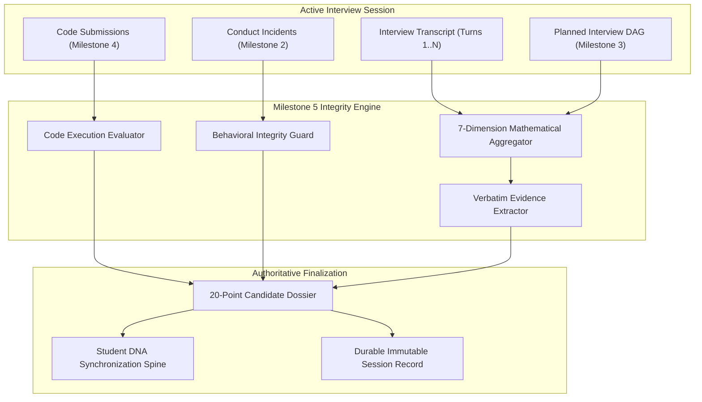

# COGNALYZE TECHNICAL INTERVIEW AGENT
# MILESTONE 5: SCOPE, ARCHITECTURE & ENGINEERING SPECIFICATION (v1)
## Candidate Assessment Integrity & Evidence Synchronization

**Document Version:** 1.0.0  
**Status:** PROPOSED ARCHITECTURAL SPECIFICATION — AWAITING EXPLICIT USER APPROVAL  
**Prerequisites:** Milestones 1, 2, 3, 3.1, and 4 verified.  
**Target Deployment:** `https://cognalyze-gules.vercel.app` (Strictly verified)  

---

## 1. RESOLUTION OF SCOPE & NAMING DISCREPANCY

### 1.1 The Discrepancy
Two competing scopes have been referenced for Milestone 5:
- **Earlier Scope:** *Integrity & Evidence Synchronization* (Candidate assessment mathematical engine, verbatim transcript extraction, unassessed competency protection, and Student DNA spine synchronization).
- **Latest Proposed Scope:** *Recruiter Report & Decision Room* (Enterprise recruiter hiring recommendation engine, candidate comparative ranking, anti-cheat telemetry review, and decision room UI).

### 1.2 Architectural Resolution: Sequential Two-Milestone Decoupling
These two scopes serve distinct architectural roles, separate personas, and different security boundaries:
- **Milestone 5 (Candidate Assessment Integrity & Evidence Synchronization):**  
  The candidate-facing evaluation and persistence spine. It computes the authoritative mathematical scorecard across the 7 technical dimensions, aggregates coding execution and conduct incidents, validates transcript quotes, and synchronizes verified claims to the Student DNA ledger.
- **Milestone 6 (Recruiter Report & Decision Room):**  
  The enterprise recruiter evaluation system. It consumes the authoritative scorecard from Milestone 5, benchmarks candidates against the JD Competency Matrix, computes hiring recommendations (`Strong Hire`, `Hire`, `Leaning Hire`, `Leaning No Hire`, `Strong No Hire`), renders code playback and paste telemetry in the Decision Room, and generates recruiter dossiers.

**Conclusion:** Neither scope is discarded or silently merged. Milestone 5 is dedicated to **Assessment Integrity & Evidence Synchronization**, establishing the authoritative data foundation for Milestone 6 (**Recruiter Decision Room**).

---

## 2. MILESTONE 5 OBJECTIVES & REQUIREMENTS

### 2.1 Core Objectives
1. **7-Dimension Mathematical Competency Scoring:** Replace the legacy 4-category scorecard with the calibrated 7 dimensions defined in Phase 0.
2. **Unassessed Competency Protection:** Competencies not directly probed during the interview remain in state `NOT_ASSESSED` (never assigned 0 or filled with arbitrary averages).
3. **Verbatim Evidence Anchoring:** Every competency claim, strength, and deduction must cite a direct verbatim quote from the interview transcript or code execution output.
4. **Multimodal Evaluation Convergence:** Synthesize oral technical reasoning, hands-on coding submissions (`codeSubmissions`), and behavioral conduct records (`conductIncidents`) into a single, cohesive evaluation record.
5. **Student DNA Ledger Synchronization:** High-confidence demonstrated skills are committed to the candidate's persistent Student DNA profile with cryptographic provenance anchors.
6. **Actionable Candidate Feedback:** Produce a constructive candidate dossier detailing demonstrated strengths, identified growth areas, and personalized engineering study tracks.

---

## 3. ARCHITECTURAL DESIGN & COMPONENT SPECIFICATIONS



### 3.1 The 7 Calibrated Competency Dimensions

Every completed interview session is evaluated across 7 distinct dimensions:

| Dimension ID | Dimension Name | Evaluation Focus |
| :--- | :--- | :--- |
| **DIM-1** | **Technical Fundamentals** | Computer science core, memory management, protocol semantics, complexity theory. |
| **DIM-2** | **Problem Solving & Algorithms** | Edge-case decomposition, optimal data structure selection, algorithmic intuition. |
| **DIM-3** | **Practical Implementation** | Code cleanliness, hands-on debugging, defensive programming, API design. |
| **DIM-4** | **System Design & Architecture** | Distributed trade-offs, scalability, failure domains, state persistence patterns. |
| **DIM-5** | **Project Ownership & Experience** | Verification of claimed 12-point project profile, personal contribution vs templates. |
| **DIM-6** | **Technical Communication** | Clarity of reasoning, structured explanation, precision, receptiveness to hints. |
| **DIM-7** | **Job Role Relevance** | Competency match against targeted JD must-have and good-to-have requirements. |

### 3.2 Mathematical Score Computation Rules
1. **Item-Level Evaluation:** Each evaluated turn earns an item score $S_i \in [0, 100]$ based on the calibrated rubric.
2. **Dimension Score:** For each dimension $d$, the score is the arithmetic mean of evaluated items mapped to that dimension:
   $$S_d = \frac{1}{|I_d|} \sum_{i \in I_d} S_i \quad \text{where } |I_d| > 0$$
   If $|I_d| = 0$, the dimension status is strictly set to `NOT_ASSESSED`, and $S_d$ is excluded from the overall average.
3. **Overall Score:** Calculated strictly over assessed dimensions:
   $$S_{\text{overall}} = \frac{\sum_{d \in D_{\text{assessed}}} w_d S_d}{\sum_{d \in D_{\text{assessed}}} w_d}$$
   Where $w_d$ represents the normalized weight of the dimension for the targeted role track.
4. **Independent Scoring of Conduct:** Behavioral infractions do **not** decrease $S_d$ or $S_{\text{overall}}$. Conduct incidents are recorded independently in a dedicated `ConductScorecard`.

---

## 4. VERBATIM EVIDENCE ANCHORING SPECIFICATION

To prevent hallucinated evaluation summaries, every claim in the final report must link to verbatim evidence:

```typescript
export interface VerbatimEvidenceAnchor {
  turnIndex: number;
  questionExcerpt: string;
  candidateQuote: string;
  codeSubmissionId?: string;
  demonstratedTopic: string;
  evaluationNote: string;
}

export interface DimensionAssessmentRecord {
  dimensionId: string;
  dimensionName: string;
  status: "DEMONSTRATED_COMPETENCY" | "DEMONSTRATED_WEAKNESS" | "INSUFFICIENT_EVIDENCE" | "NOT_ASSESSED";
  score: number | null;
  evidenceAnchors: VerbatimEvidenceAnchor[];
  strengths: string[];
  growthAreas: string[];
}
```

---

## 5. STUDENT DNA LEDGER SYNCHRONIZATION

### 5.1 Verification Thresholds
Only competencies meeting strict evidence criteria are committed to the persistent Student DNA store (`data/dna-store.json` / Supabase `student_dna`):
1. **Minimum Confidence:** At least 2 independent turns with score $\ge 75$, OR a passed coding challenge at $N = 10^5$.
2. **Provenance Tagging:** Demonstrated skills are tagged as `VERIFIED_INTERVIEW_EVIDENCE` with the session ID and turn indices attached.
3. **No Hallucination Rule:** Skills that were merely claimed on the resume but failed live probing are flagged as `UNVERIFIED_CANDIDATE_CLAIM`.

---

## 6. DATA MODEL & SCHEMA SPECIFICATIONS

### 6.1 Supabase Schema Updates (`supabase/migrations/20261108_milestone5_final_report.sql`)
```sql
-- Final Interview Assessment Reports
CREATE TABLE IF NOT EXISTS public.interview_final_reports (
  id TEXT PRIMARY KEY DEFAULT gen_random_uuid()::TEXT,
  session_id TEXT NOT NULL REFERENCES public.interview_sessions(id) ON DELETE CASCADE,
  candidate_id TEXT NOT NULL,
  target_role TEXT NOT NULL,
  overall_score NUMERIC NOT NULL,
  dimension_scores JSONB NOT NULL,
  coding_evaluation JSONB DEFAULT '{}'::JSONB,
  conduct_scorecard JSONB DEFAULT '{}'::JSONB,
  verbatim_evidence JSONB NOT NULL,
  strengths TEXT[] DEFAULT '{}',
  growth_areas TEXT[] DEFAULT '{}',
  dna_sync_status TEXT DEFAULT 'PENDING',
  created_at TIMESTAMPTZ DEFAULT now()
);

-- RLS: Candidates view own final reports
ALTER TABLE public.interview_final_reports ENABLE ROW LEVEL SECURITY;
CREATE POLICY "Candidate access own final report"
  ON public.interview_final_reports FOR SELECT
  USING (auth.uid()::TEXT = candidate_id);
```

---

## 7. PLANNED TEST SPECIFICATION (AC-M5-1 TO AC-M5-12)

| Test ID | Scenario | Expected Outcome |
| :--- | :--- | :--- |
| **AC-M5-1** | 7-Dimension Mathematical Calculation | Verified that all 7 dimensions compute scores from mapped item turns without lumping. |
| **AC-M5-2** | Unassessed Competency Preservation | Unassessed dimension remains `NOT_ASSESSED` with `score: null`; not factored into overall average. |
| **AC-M5-3** | Verbatim Quote Grounding | Every score justification cites an exact substring quote from the transcript. |
| **AC-M5-4** | Multimodal Coding Challenge Synthesis | Final report incorporates Milestone 4 code submission verdict, runtime, and complexity probe. |
| **AC-M5-5** | Conduct Independence Guarantee | Severe abuse warning does not modify technical competency scores. |
| **AC-M5-6** | Student DNA Skill Ledger Commit | Demonstrated skills committed with `VERIFIED_INTERVIEW_EVIDENCE` provenance tag. |
| **AC-M5-7** | Student DNA Invalidation on Failure | Failed topic claims remain `UNVERIFIED_CLAIM` in Student DNA. |
| **AC-M5-8** | Completed Session Immutability | Re-requesting report finalization returns identical cached report without re-computation. |
| **AC-M5-9** | Candidate Multi-Tenant Isolation | Requesting report for `session_id` belonging to another candidate returns HTTP 403. |
| **AC-M5-10** | Offline Model Finalization Fallback | When Groq inference fails, deterministic template synthesizer creates mathematically valid report. |
| **AC-M5-11** | Actionable Study Track Generation | Recommends targeted study modules for dimensions marked `DEMONSTRATED_WEAKNESS`. |
| **AC-M5-12** | Database Transaction Atomicity | Session status update and report persistence commit atomically. |

---

## 8. EXECUTION BOUNDARY & IMPLEMENTATION GATE

**STRICT DIRECTIVE:**  
- Milestone 5 implementation is **BLOCKED** pending user review and explicit authorization.
- No code, migrations, or tests for Milestone 5 have been implemented.
- We await explicit approval to proceed with Milestone 5 implementation.

