# COGNALYZE TECHNICAL INTERVIEW AGENT
# MILESTONE 5: SCOPE, ARCHITECTURE & ENGINEERING SPECIFICATION (v2)
## Candidate Assessment Integrity & Student DNA Synchronization

**Document Version:** 2.0.0  
**Status:** ARCHITECTURAL SPECIFICATION — AWAITING EXPLICIT USER IMPLEMENTATION GATE APPROVAL  
**Prerequisites:** Milestones 1, 2, 3, 3.1, 4, and 4.1 fully remediated and verified.  
**Target Deployment:** `https://cognalyze-gules.vercel.app` (Strictly verified)  
**Security Boundary:** Design specification only. No Milestone 5 code has been written.

---

## 1. SCOPE DEFINITION & THE TWO-MILESTONE DECOUPLING

As verified in the forensic audit, Milestone 5 and Milestone 6 serve distinct user personas, data models, and security boundaries:

```mermaid
flowchart LR
    subgraph Milestone5 ["Milestone 5 (Candidate & Integrity Spine)"]
        direction TB
        M5_1["7-Dimension Mathematical Engine"]
        M5_2["Verbatim Quote Grounding"]
        M5_3["NOT_ASSESSED Dimension Protection"]
        M5_4["Tri-Anchor Student DNA Sync"]
        M5_5["Candidate Performance Dossier"]
    end

    subgraph Milestone6 ["Milestone 6 (Recruiter Decision Room)"]
        direction TB
        M6_1["Enterprise Hiring Recommendations"]
        M6_2["Candidate Comparative Benchmarking"]
        M6_3["Code Playback & Keystroke Telemetry"]
        M6_4["Recruiter Override & Calibration Audit"]
        M6_5["Decision Room UI & Dossier PDF"]
    end

    Milestone5 -->|Authoritative Certified Scorecard| Milestone6
```



- **Milestone 5 (Candidate Assessment Integrity & Student DNA Sync):**  
  The candidate-facing mathematical evaluation and identity sync engine. Computes the authoritative scorecard across the 7 dimensions, ensures mathematically sound `NOT_ASSESSED` handling, extracts verbatim transcript citations, synthesizes sandbox code submissions, and securely commits verified technical skills to the Student DNA persistent ledger.
- **Milestone 6 (Recruiter Report & Decision Room):**  
  The enterprise recruiter hiring decision suite. Consumes the authoritative scorecard from Milestone 5, benchmarks candidates against the JD Competency Matrix, renders the interactive Decision Room, displays code playback with paste-advisory telemetry, and generates recruiter dossiers.

---

## 2. THE 7 COMPETENCY DIMENSIONS & TRACK WEIGHT MATRIX

### 2.1 The 7 Calibrated Competency Dimensions

Every completed interview session evaluates candidate evidence against 7 canonical engineering dimensions:

1. **`DIM_1_TECH_FUNDAMENTALS` (Technical Fundamentals):** Core computer science foundations, memory models, protocol semantics, concurrency primitives, complexity intuition.
2. **`DIM_2_PROBLEM_SOLVING` (Problem Solving & Algorithms):** Algorithmic decomposition, edge-case identification, space/time trade-off optimization.
3. **`DIM_3_PRACTICAL_IMPL` (Practical Implementation & Hands-on Code):** Milestone 4 sandbox code execution, clean idiomatic syntax, test pass rate, defensive programming.
4. **`DIM_4_SYSTEM_DESIGN` (System Design & Architecture):** High-level architecture, scalability, state persistence, failure domains, consensus and caching trade-offs.
5. **`DIM_5_PROJECT_EXPERIENCE` (Project Ownership & Experience):** Verification of claimed resume projects (12-point intelligence profile), architectural decisions, depth of individual ownership.
6. **`DIM_6_COMMUNICATION` (Technical Communication):** Precision of thought, structured explanations, active listening, handling hints and counterfactual challenges.
7. **`DIM_7_ROLE_RELEVANCE` (Job Role Relevance):** Alignment with JD must-have and good-to-have technologies, domain-specific best practices.

### 2.2 Track Weight Matrix ($w_d$)

Dimension weights vary systematically by engineering track to reflect authentic job expectations. Each row strictly sums to $1.00$ ($100\%$):

| Track ID | Track Name | DIM_1 (Fund.) | DIM_2 (Algo) | DIM_3 (Code) | DIM_4 (Design) | DIM_5 (Proj.) | DIM_6 (Comm.) | DIM_7 (JD Rel.) | Total |
| :--- | :--- | :---: | :---: | :---: | :---: | :---: | :---: | :---: | :---: |
| **`fullstack`** | Full-Stack Engineering | 0.15 | 0.15 | 0.20 | 0.15 | 0.15 | 0.10 | 0.10 | **1.00** |
| **`backend`** | Backend Systems | 0.15 | 0.15 | 0.20 | 0.20 | 0.15 | 0.05 | 0.10 | **1.00** |
| **`frontend`** | Modern Frontend | 0.10 | 0.10 | 0.25 | 0.15 | 0.15 | 0.10 | 0.15 | **1.00** |
| **`systems`** | Low-Level Systems & Infra | 0.25 | 0.15 | 0.25 | 0.15 | 0.10 | 0.05 | 0.05 | **1.00** |
| **`devops`** | DevOps & Cloud Platform | 0.15 | 0.05 | 0.15 | 0.25 | 0.20 | 0.05 | 0.15 | **1.00** |
| **`ml_data`** | AI / Data Engineering | 0.15 | 0.20 | 0.20 | 0.15 | 0.15 | 0.05 | 0.10 | **1.00** |
| **`security`** | Application Security | 0.20 | 0.10 | 0.20 | 0.20 | 0.15 | 0.05 | 0.10 | **1.00** |
| **`general_swe`**| Core Software Engineering | 0.15 | 0.20 | 0.25 | 0.15 | 0.10 | 0.05 | 0.10 | **1.00** |

---

## 3. MATHEMATICAL SCORE AGGREGATION & NOT_ASSESSED HANDLING

### 3.1 Item-Level Scoring
Each candidate response (or sandbox code submission) mapped to dimension $d$ receives an item score $S_i \in [0, 100]$ based on the calibrated rubric.

### 3.2 Dimension Score Computation
For any dimension $d$ with evaluated items $I_d$:
$$S_d = \frac{1}{|I_d|} \sum_{i \in I_d} S_i \quad \text{for } |I_d| > 0$$

If $|I_d| = 0$, dimension $d$ is classified strictly as:
$$\text{Status}(d) = \text{NOT\_ASSESSED}, \quad S_d = \text{null}$$

### 3.3 Dynamic Re-Weighting & Distortion Elimination
**Core Invariant:** An unassessed dimension must **never** be assigned a score of `0`, nor should it be imputed with arbitrary default constants. A candidate who was simply not asked about System Design during a 20-minute junior frontend screen must not suffer an artificial $15\%$ score penalty.

Instead, the overall certified score is computed via **dynamic weight re-normalization** over only the assessed dimensions $D_{\text{assessed}} = \{ d \mid \text{Status}(d) \neq \text{NOT\_ASSESSED} \}$:

$$S_{\text{overall}} = \frac{\sum_{d \in D_{\text{assessed}}} w_d \cdot S_d}{\sum_{d \in D_{\text{assessed}}} w_d}$$

### 3.4 Minimum Assessment Coverage Threshold
To prevent a session with only 1 shallow answer producing an artificial $100\%$ certified score:
1. **Minimum Assessed Dimensions:** At least **4 of the 7 dimensions** must be evaluated ($|D_{\text{assessed}}| \ge 4$).
2. **Minimum Track Weight Coverage:** $\sum_{d \in D_{\text{assessed}}} w_d \ge 0.60$ ($60\%$ of the track's total potential weight).
3. **Threshold Enforcement:**
   $$\text{If } |D_{\text{assessed}}| < 4 \lor \sum_{d \in D_{\text{assessed}}} w_d < 0.60 \implies S_{\text{overall}} = \text{null}, \quad \text{Status} = \text{"ASSESSMENT\_INCOMPLETE"}$$
   This guarantees that short or aborted sessions clearly report incomplete data rather than false scores.

---

## 4. EVIDENCE PROVENANCE HIERARCHY & STUDENT DNA COMMIT ELIGIBILITY

### 4.1 The 5-Tier Provenance Hierarchy
All technical claims and competencies in Cognalyze are categorized into a 5-tier confidence hierarchy:

| Provenance Level | Tag Identifier | Confidence Weight | Verification Requirement |
| :--- | :--- | :---: | :--- |
| **Level 1** | `PROVENANCE_LEVEL_1_VERIFIED_INTERVIEW_SANDBOX` | **1.00** | Interactive coding problem solved with `ACCEPTED` sandbox verdict at $N = 10^5$, optimal complexity, zero cheat flags. |
| **Level 2** | `PROVENANCE_LEVEL_2_VERIFIED_INTERVIEW_THEORY` | **0.85** | Candidate successfully defended architectural trade-offs across $\ge 2$ distinct stages with counterfactual probing. |
| **Level 3** | `PROVENANCE_LEVEL_3_EXTERNALLY_AUDITED` | **0.70** | External verified source: GitHub repository commit telemetry, LeetCode verified handle, or enterprise badge. |
| **Level 4** | `PROVENANCE_LEVEL_4_UNVERIFIED_CANDIDATE_CLAIM` | **0.25** | Unsubstantiated resume statement or student self-attestation that has not yet been tested in an interview. |
| **Level 5** | `PROVENANCE_LEVEL_5_CONTRADICTED_OR_FAILED` | **0.00** | Competency claimed on resume, but candidate repeatedly failed basic probes or failed test cases during live evaluation. |

### 4.2 Challenging the 2-Turn Rule: The Tri-Anchor Verification Invariant
In earlier prototypes, a competency was committed to permanent Student DNA if the candidate answered just 2 consecutive questions correctly. In forensic review, this was found vulnerable to lucky guesses, memorized cheat sheets, or narrow LLM questioning.

Milestone 5 replaces this with the **Tri-Anchor Verification Standard**:
Before any competency is committed to permanent Student DNA as `VERIFIED_INTERVIEW_EVIDENCE`:
1. **Cross-Stage Consistency:** The competency must be demonstrated across **at least two distinct interview stages** (e.g. Stage 2 project deep-dive AND Stage 4 system design trade-off probe).
2. **Depth of Inquiry:** At least **3 independent conversational turns** on that topic, including at least one counterfactual probe ("What would break if we replaced X with Y?").
3. **Hands-On Verification (for Algorithmic/Coding Competencies):** If the skill is DSA or coding-related, conversational turns alone are insufficient. The candidate must have executed an `ACCEPTED` solution in the Judge0 sandbox (Milestone 4).
4. **Performance Threshold:** The aggregated item score across these items must be $\ge 80/100$, with zero cheat or abusive conduct incidents during those turns.

If a competency meets some criteria but fails the tri-anchor bar, it is persisted in the session report but **remains in status `UNVERIFIED_CANDIDATE_CLAIM`** in the persistent Student DNA store.

---

## 5. SOURCE-OF-TRUTH ARCHITECTURE: SUPABASE VS LOCAL DNA STORE

```mermaid
flowchart TD
    subgraph Client ["Interview Assessment Engine"]
        Finalizer["Interview Finalizer Service"]
    end

    subgraph SupabaseDB ["Authoritative Cloud Storage (PostgreSQL + RLS)"]
        direction TB
        ReportsTable["public.interview_final_reports (Authoritative)"]
        DNAEventsTable["public.student_dna_events (Immutable Audit Log)"]
        DNAStateTable["public.student_dna (Current Aggregated State)"]
    end

    subgraph LocalCache ["Ephemeral Local Disk (Sandboxed Dev/Test Only)"]
        DiskJSON["data/dna-store.json (Dev/Test Fallback Cache Only)"]
    end

    Finalizer -->|1. ACID Transaction (BEGIN ... COMMIT)| SupabaseDB
    SupabaseDB -->|2. Asynchronous Read-Through Cache| LocalCache
```

### 5.1 Authoritative Source of Truth: Supabase PostgreSQL
1. **Authoritative Record:** Supabase PostgreSQL is the sole, binding source of truth for all candidate evaluations, final reports, and Student DNA profiles.
2. **ACID Transaction Boundary:** All report finalization and DNA updates must commit inside a single atomic database transaction (`BEGIN ... COMMIT`).
3. **Multi-Tenant Protection via Row Level Security (RLS):**
   - Candidates can only SELECT their own final reports (`auth.uid() = candidate_id`).
   - Recruiters can only SELECT reports for candidates who have applied to their organization's job postings (`organization_id` matching).
   - Direct mutations to `student_dna` are restricted to signed service role calls executing from the finalizer backend.

### 5.2 Role of `data/dna-store.json`
`data/dna-store.json` is strictly an ephemeral local development and unit testing fixture. It must **never** be treated as authoritative in production. If Supabase is connected, the application reads and writes exclusively to PostgreSQL. In local offline test suites (`NODE_ENV === "test"`), the store acts as a sandboxed in-memory/disk stub.

---

## 6. VERBATIM TRANSCRIPT & CODE SUBMISSION GROUNDING

Every claim, strength, and weakness in the candidate report must be anchored to verifiable evidence:

```typescript
export interface VerbatimTranscriptAnchor {
  turnIndex: number;
  stageId: string;
  questionExcerpt: string;
  candidateQuote: string; // Verbatim substring (min 10 chars) matching transcript
  quoteHash: string;      // SHA-256 of candidate quote
  demonstratedTopic: string;
  rubricScore: number;
  evaluationNote: string;
}

export interface CodeSubmissionAnchor {
  submissionId: string;
  problemId: string;
  language: string;
  codeSha256: string;
  verdict: "ACCEPTED" | "WRONG_ANSWER" | "TIME_LIMIT_EXCEEDED" | "MEMORY_LIMIT_EXCEEDED" | "RUNTIME_ERROR";
  runtimeMs: number;
  memoryKb: number;
  stressTestPassed: boolean;
  cheatSuspicionScore: number;
  executionSource: "live_judge0" | "trusted_mock_fixture";
}

export interface DimensionAssessmentRecord {
  dimensionId: string;
  dimensionName: string;
  status: "DEMONSTRATED_COMPETENCY" | "DEMONSTRATED_WEAKNESS" | "INSUFFICIENT_EVIDENCE" | "NOT_ASSESSED";
  score: number | null;
  weight: number;
  transcriptAnchors: VerbatimTranscriptAnchor[];
  codeSubmissionAnchors?: CodeSubmissionAnchor[];
  strengths: string[];
  growthAreas: string[];
}
```

---

## 7. CONCURRENCY, IDEMPOTENCY & RECOVERY MECHANISMS

### 7.1 Idempotency & Distributed Lock
1. **Single Finalization Invariant:** An interview session can be finalized exactly once.
2. **Turn Mutex Lock:** `acquireTurnLock(sessionId, "finalize")` with a 30-second TTL prevents concurrent finalize requests.
3. **Idempotent Replay:** If a client retries a finalize request on an already finalized session, the route returns the existing report with HTTP 200 and header `X-Idempotent-Replay: true`.
4. **Unique Session Constraint:** PostgreSQL enforces `UNIQUE(session_id)` on `interview_final_reports`.

### 7.2 Two-Phase Atomic Transaction & Partial Failure Recovery
If network interruptions or server crashes occur during finalization:
```sql
BEGIN;
  -- 1. Insert immutable final report
  INSERT INTO public.interview_final_reports (...) VALUES (...);

  -- 2. Mark interview session as completed and seal it
  UPDATE public.interview_sessions 
  SET status = 'COMPLETED', final_report_id = ..., completed_at = now()
  WHERE id = $sessionId AND status = 'IN_PROGRESS';

  -- 3. Insert DNA evidence event records
  INSERT INTO public.student_dna_events (...) VALUES (...);

  -- 4. Upsert aggregated Student DNA profile
  INSERT INTO public.student_dna (...) VALUES (...)
  ON CONFLICT (student_id) DO UPDATE SET ...;
COMMIT;
```
If any statement fails, the entire transaction is rolled back. The session remains in `IN_PROGRESS` (or `FINALIZATION_FAILED`), allowing safe retries without creating orphaned records or partial state corruption.

### 7.3 Model Fallback Guarantee
If Groq LLM inference times out or fails during summary generation:
- The system automatically triggers the **Deterministic Rubric Math Synthesizer**.
- It uses exact mathematical averages, item-level evaluations, and verbatim transcript excerpts to generate the complete report without failing the user request.

---

## 8. HISTORICAL VERSIONING & AUDIT TRAILS

1. **Append-Only Event Store (`public.student_dna_events`):** Every skill addition, level increase, or contradiction is recorded as an immutable log event with timestamps, session references, and evidence hashes.
2. **Immutable Final Reports:** Once written, `interview_final_reports` cannot be modified by candidates or automated processes.
3. **Recruiter Calibration Trails (Bridge to Milestone 6):** If an enterprise hiring manager amends a score or adds an evaluation note in Milestone 6, the original report remains untouched; changes are recorded in an audit table `public.interview_report_amendments` with recruiter ID, previous score, new score, justification reason, and timestamp.

---

## 9. DATABASE SCHEMA SPECIFICATION

```sql
-- Migration: supabase/migrations/20261108_milestone5_candidate_integrity.sql

-- 1. Immutable Final Assessment Reports
CREATE TABLE IF NOT EXISTS public.interview_final_reports (
  id TEXT PRIMARY KEY DEFAULT gen_random_uuid()::TEXT,
  session_id TEXT NOT NULL UNIQUE REFERENCES public.interview_sessions(id) ON DELETE CASCADE,
  candidate_id TEXT NOT NULL,
  track_id TEXT NOT NULL,
  overall_score NUMERIC NULL,
  assessment_status TEXT NOT NULL CHECK (assessment_status IN ('COMPLETED_CERTIFIED', 'ASSESSMENT_INCOMPLETE', 'TERMINATED_MISCONDUCT')),
  dimension_scores JSONB NOT NULL,
  coding_evaluation JSONB DEFAULT '{}'::JSONB,
  conduct_scorecard JSONB DEFAULT '{}'::JSONB,
  verbatim_evidence JSONB NOT NULL,
  strengths TEXT[] DEFAULT '{}',
  growth_areas TEXT[] DEFAULT '{}',
  dna_sync_status TEXT DEFAULT 'PENDING' CHECK (dna_sync_status IN ('PENDING', 'COMMITTED', 'FAILED')),
  created_at TIMESTAMPTZ DEFAULT now()
);

-- 2. Student DNA Immutable Event Ledger
CREATE TABLE IF NOT EXISTS public.student_dna_events (
  id TEXT PRIMARY KEY DEFAULT gen_random_uuid()::TEXT,
  student_id TEXT NOT NULL,
  session_id TEXT NOT NULL REFERENCES public.interview_sessions(id),
  competency_id TEXT NOT NULL,
  provenance_level TEXT NOT NULL,
  confidence_score NUMERIC NOT NULL,
  evidence_summary TEXT NOT NULL,
  created_at TIMESTAMPTZ DEFAULT now()
);

-- 3. Row Level Security
ALTER TABLE public.interview_final_reports ENABLE ROW LEVEL SECURITY;
ALTER TABLE public.student_dna_events ENABLE ROW LEVEL SECURITY;

CREATE POLICY "Candidates view their own reports"
  ON public.interview_final_reports FOR SELECT
  USING (auth.uid()::TEXT = candidate_id);

CREATE POLICY "Candidates view their own DNA events"
  ON public.student_dna_events FOR SELECT
  USING (auth.uid()::TEXT = student_id);
```

---

## 10. PLANNED VERIFICATION TEST FLEET (AC-M5-1 TO AC-M5-12)

| Test ID | Scenario | Verification Focus | Expected Result |
| :--- | :--- | :--- | :--- |
| **AC-M5-1** | 7-Dimension Mathematical Computation | Computes exact arithmetic means per dimension from evaluated item turns. | Scores match rubric items; track weights applied properly. |
| **AC-M5-2** | Unassessed Dimension Protection | Evaluates session where System Design (`DIM_4`) was not probed. | Status is `NOT_ASSESSED`, `score: null`, overall score re-weights remaining 6 dimensions without penalty. |
| **AC-M5-3** | Incomplete Session Threshold | Evaluates session with only 2 turns assessed ($< 4$ dimensions, $< 60\%$ track weight). | Overall score is `null`, status is `ASSESSMENT_INCOMPLETE`. |
| **AC-M5-4** | Tri-Anchor Student DNA Commit | Candidate demonstrates Redis across Stage 2 and Stage 4 over 3 turns with $\ge 80$ score. | Redis committed to Student DNA as `PROVENANCE_LEVEL_2_VERIFIED_INTERVIEW_THEORY`. |
| **AC-M5-5** | Single-Phase Memorization Rejection | Candidate answers 2 questions well in Stage 2 only, but fails follow-up in Stage 4. | Redis NOT committed as verified; tagged as `UNVERIFIED_CANDIDATE_CLAIM`. |
| **AC-M5-6** | Sandbox Coding Synthesis | Evaluates candidate with `ACCEPTED` $N = 10^5$ solution in Milestone 4 sandbox. | `DIM_3` scored $100\%$, committed with `PROVENANCE_LEVEL_1_VERIFIED_INTERVIEW_SANDBOX`. |
| **AC-M5-7** | Verbatim Quote Hash Verification | Every score claim cites exact substring quote from candidate answers. | System verifies substring exists in transcript and matches SHA-256 hash. |
| **AC-M5-8** | Conduct Infraction Independence Guarantee | Candidate receives a conduct warning in Milestone 2 for mild disrespect. | Technical competency score is NOT lowered; conduct incident isolated to `conduct_scorecard`. |
| **AC-M5-9** | Session Finalization Idempotency | Client sends duplicate concurrent finalize requests for same session. | Second request returns identical report with `X-Idempotent-Replay: true`. |
| **AC-M5-10** | Database Transaction Atomicity & Rollback | Simulates failure during DNA event insertion. | Entire transaction rolls back; session remains un-finalized for retry. |
| **AC-M5-11** | Multi-Tenant Authorization Guard | Candidate A attempts to access Candidate B's final report. | Returns HTTP 403 `TENANT_ACCESS_DENIED`. |
| **AC-M5-12** | Offline Model Synthesizer Fallback | Simulates Groq network timeout during report generation. | Fallback synthesizer produces valid mathematical scorecard and study tracks. |

---

## 11. EXECUTION GATE DIRECTIVE

**STRICT IMPLEMENTATION LOCK:**  
- **Milestone 5 implementation remains BLOCKED.**
- No code, database migrations, or test files for Milestone 5 have been created.
- The engineering team will halt and await explicit user authorization before writing any Milestone 5 code.

