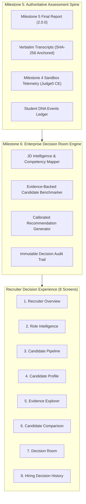
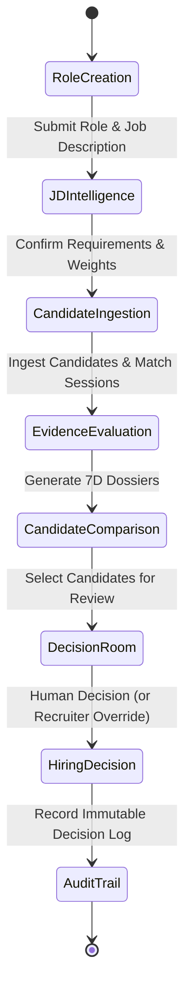
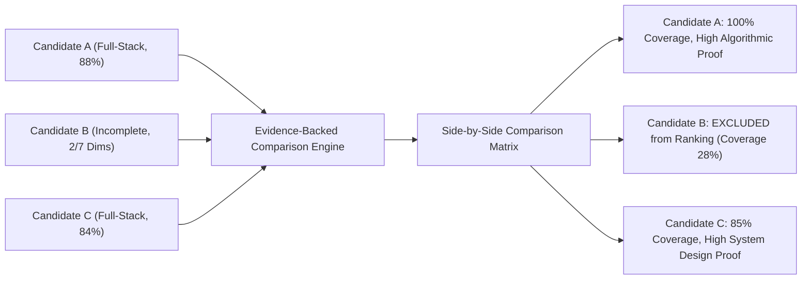
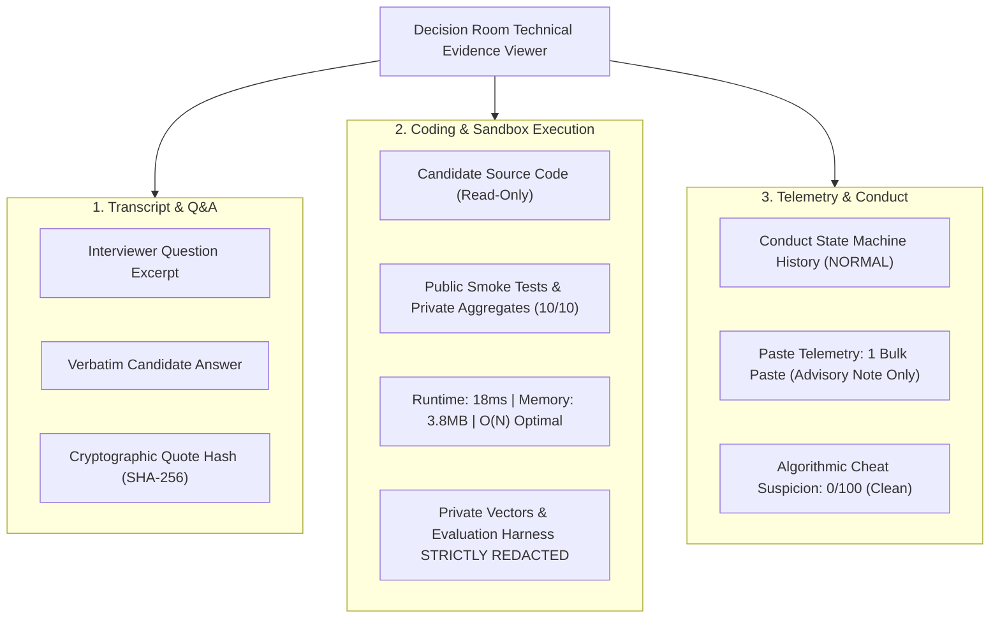

# COGNALYZE TECHNICAL INTERVIEW AGENT
# MILESTONE 6: SCOPE, ARCHITECTURE & ENGINEERING SPECIFICATION (v1)
## Recruiter Decision Room & Enterprise Hiring Dossier

**Document Version:** 1.0.0  
**Status:** ARCHITECTURAL SPECIFICATION — AWAITING EXPLICIT USER IMPLEMENTATION GATE APPROVAL  
**Prerequisites:** Milestones 1, 2, 3, 3.1, 4, 4.1, 5, and 5.1 fully audited and verified.  
**Target Deployment:** `https://cognalyze-gules.vercel.app` (Strictly verified)  
**Security Boundary:** Design specification only. No Milestone 6 implementation code has been written.

---

## 1. CORE PRODUCT OBJECTIVE & ARCHITECTURAL FOUNDATION

The **Recruiter Decision Room & Enterprise Hiring Dossier** is the enterprise evaluation environment of Cognalyze. It translates the candidate-facing assessment integrity engine (Milestone 5) into an evidence-first, explainable hiring intelligence suite for engineering managers, technical recruiters, and talent directors.



### 1.1 Core Principles
1. **Explainable AI, Never Autonomous Hiring:** The AI analyzes, cross-references, and explains evidence across 5 calibrated recommendation bands (`Strong Hire`, `Hire`, `Hold`, `No Hire`, `Strong No Hire`). It **never** makes autonomous, unreviewable hiring decisions.
2. **Evidence Coverage Over Aggregate Averages:** Giant single numbers hide missing competencies. The Decision Room prominently displays **Evidence Coverage Ratio** and preserves `NOT_ASSESSED` dimensions.
3. **Strict Separation of Candidate DNA and Recruiter Deliberations:** Recruiters consume immutable assessment snapshots. Recruiter comments, ratings, and overrides are stored in dedicated enterprise audit tables; they cannot modify the student's personal DNA ledger or rewrite interview scores.
4. **Advisory Telemetry:** Paste alerts and keystroke anomalies are presented as **contextual recruiter notes**, never automated competency penalties.

---

## 2. THE END-TO-END RECRUITER WORKFLOW

The hiring workflow follows an 8-stage state machine with strict transition preconditions:



### 2.1 Stage Transitions & Data Contracts

| Stage | Trigger / Action | Preconditions | Input Data Contract | Output State / Artifact |
| :--- | :--- | :--- | :--- | :--- |
| **1. Role Creation** | Recruiter defines title, level, track, and organization. | Authenticated Recruiter with valid `organization_id`. | `{ organizationId, title, level, track }` | `role_id` created in status `DRAFT`. |
| **2. JD Intelligence** | Paste raw JD or upload PDF/text. | Valid role in status `DRAFT`. | `{ roleId, rawJdText }` | Structured JD Competencies (`mustHave`, `goodToHave`, `dimensionWeights`). |
| **3. Candidate Ingestion** | Bulk import candidate IDs or application links. | Active confirmed role. | `{ roleId, candidateIds[] }` | Candidates attached to role pipeline in status `EVALUATING`. |
| **4. Evidence Evaluation** | Hydrate Milestone 5 final reports for candidates. | Valid session IDs linked to candidate. | `{ sessionId, candidateId }` | 7-Dimension Dossier Snapshots loaded with verbatim quotes and sandbox code. |
| **5. Candidate Comparison** | Recruiter selects 2–5 candidates for side-by-side review. | At least 2 candidates with evaluated reports. | `{ roleId, candidateIds[2..5] }` | Comparative Rubric Matrix with coverage percentages and gap flags. |
| **6. Decision Room** | Recruiter opens individual candidate deep-dive. | Single candidate dossier selected. | `{ roleId, candidateId }` | Full Decision Room: Recommendation band, evidence explorer, paste telemetry. |
| **7. Hiring Decision** | Recruiter logs verdict (`Advance`, `Offer`, `Hold`, `Reject`). | Completed dossier review. If overriding AI, `overrideReason` is mandatory. | `{ roleId, candidateId, verdict, recruiterNotes, overrideReason? }` | Sealed hiring decision recorded with timestamp and recruiter identity. |
| **8. Audit Trail** | Decision committed to immutable ledger. | Valid sealed decision. | Decision payload | Append-only log in `recruiter_decision_audit`. |

---

## 3. JD INTELLIGENCE & 7-DIMENSION MAPPING

The JD Intelligence engine parses unstructured job descriptions into calibrated technical requirement sets:

```typescript
export interface JDIntelligenceProfile {
  roleId: string;
  title: string;
  experienceLevel: "intern" | "entry_level" | "mid_level" | "senior" | "staff" | "principal";
  trackId: "fullstack" | "backend" | "frontend" | "systems" | "devops" | "ml_data" | "security" | "general_swe";
  mustHaveCompetencies: CompetencyRequirement[];
  goodToHaveCompetencies: CompetencyRequirement[];
  unsupportedOrAmbiguous: string[];
  calibratedDimensionWeights: Record<string, number>;
}

export interface CompetencyRequirement {
  id: string;
  name: string;
  dimensionId: string; // Maps to DIM_1 through DIM_7
  minimumProvenanceRequired: string; // e.g. PROVENANCE_LEVEL_2_VERIFIED_INTERVIEW_THEORY
  evidenceExpectation: string; // What candidate must demonstrate
  weight: number; // 0.0 - 1.0
}
```

### 3.1 Mapping Requirements to the 7 Canonical Dimensions
Keyword matching is strictly prohibited. Every JD requirement is mapped to one of the 7 canonical dimensions:
- **`DIM_1_TECH_FUNDAMENTALS`:** OS concepts, memory management, networking protocols, concurrency.
- **`DIM_2_PROBLEM_SOLVING`:** Data structures, asymptotic analysis, edge-case decomposition.
- **`DIM_3_PRACTICAL_IMPL`:** Milestone 4 sandbox code pass rate, optimal runtime, clean syntax.
- **`DIM_4_SYSTEM_DESIGN`:** Scalability, distributed caching, partition tolerance, database sharding.
- **`DIM_5_PROJECT_EXPERIENCE`:** 12-point project profile verification, individual contribution depth.
- **`DIM_6_COMMUNICATION`:** Precision of reasoning, proactive trade-off articulation, hint responsiveness.
- **`DIM_7_ROLE_RELEVANCE`:** Direct alignment with role must-haves and tech stack specifics.

---

## 4. CANDIDATE COMPARISON & BENCHMARKING ENGINE



### 4.1 Comparison Rules & Guardrails
1. **No Ranking on Incomplete Data:** Candidates with `status: "ASSESSMENT_INCOMPLETE"` (coverage $< 60\%$ or $< 4$ dimensions) are explicitly flagged with a badge: `ASSESSMENT INCOMPLETE — CANNOT BE RANKED`. They are grouped separately to prevent unfair bias.
2. **`NOT_ASSESSED` Preservation:** Unvisited dimensions are rendered as `—` (Not Assessed), never `0` or an estimated average.
3. **Verified vs Self-Claimed Separation:** The comparison grid displays:
   - **Verified Skills:** Count of skills meeting Tri-Anchor verification (`PROVENANCE_LEVEL_1` or `2`).
   - **Self-Claimed Skills:** Count of unverified resume claims (`PROVENANCE_LEVEL_4`).
   - **Contradicted Claims:** Claims that failed live probing (`PROVENANCE_LEVEL_5`).

---

## 5. DECISION ROOM: RECOMMENDATION ENGINE & RECRUITER OVERRIDE

### 5.1 The 5 Calibrated Recommendation Bands

| Recommendation Band | Criteria & Evidence Preconditions | System Output & Explanation |
| :--- | :--- | :--- |
| **`STRONG_HIRE`** | Overall Score $\ge 85$, all must-have competencies verified with Level 1 or 2 provenance, coding problem solved optimally ($N = 10^5$), zero misconduct incidents, coverage $\ge 85\%$. | High conviction. Candidate exceeded benchmarks across coding, system design, and communication. |
| **`HIRE`** | Overall Score $\ge 72$, $\ge 80\%$ must-haves verified, sandbox coding passed, zero severe conduct infractions, coverage $\ge 60\%$. | Solid technical capability with defensible implementation evidence across primary role requirements. |
| **`HOLD`** | Overall Score $60 - 71$, OR candidate demonstrated strong theory but marginal coding execution, OR single critical must-have unassessed. | Mixed signals or incomplete evidence. Requires targeted follow-up or secondary technical screen. |
| **`NO_HIRE`** | Overall Score $< 60$, OR candidate failed primary coding challenge, OR multiple critical must-haves unverified. | Below hiring bar for the targeted role level. Concrete gaps identified in implementation or architecture. |
| **`STRONG_NO_HIRE`** | Critical misconduct termination (`TERMINATED`), OR fraudulent cheat table detected in coding challenge (`cheatSuspicionScore >= 50`), OR widespread resume fabrication. | Disqualified on integrity, fraud, or severe misconduct grounds. |

### 5.2 Mandatory Recruiter Override Protocol
When a recruiter makes a decision that differs from the AI recommendation (e.g. marking `Advance` on a `NO_HIRE` recommendation or `Reject` on a `STRONG_HIRE` recommendation):
1. **`isOverride` flag:** Set to `true`.
2. **Mandatory Justification (`overrideReason`):** Minimum 20 characters explaining the business or technical justification (e.g. *"Candidate demonstrated exceptional specialized proprietary domain experience in follow-up interview"*).
3. **Audit Immutability:** Overrides are permanently recorded in `public.recruiter_decision_audit` with the recruiter's user ID, timestamp, and IP address.

---

## 6. TECHNICAL EVIDENCE VIEWER & INTEGRITY SIGNALS

The Decision Room provides an interactive technical evidence viewer enabling recruiters to inspect the primary artifacts:



### 6.1 Security & Redaction Invariants
- **Private Test Vector Redaction:** Recruiters see private test counts (e.g. *10/10 private evaluation vectors passed*) and runtime telemetry, but private test vectors and Judge0 harness secrets are **strictly redacted** from the UI and API payloads.
- **Advisory Paste Telemetry:** Bulk paste events (Milestone 4) are displayed with timestamps and character counts, tagged with an informational notice: *"Bulk paste event observed (often indicates local IDE development or template code). This is advisory telemetry and does not penalize technical scoring."*

---

## 7. DATA BOUNDARIES & SEPARATION OF CONCERNS

```mermaid
flowchart LR
    subgraph CandidateDomain ["Candidate Data Domain (Candidate-Owned)"]
        StudentDNA["public.student_dna"]
        DNAEvents["public.student_dna_events"]
        SessionHistory["public.interview_sessions"]
    end

    subgraph ReadOnlyBridge ["Read-Only Assessment Snapshot"]
        FinalReports["public.interview_final_reports (Versioned Snapshot)"]
    end

    subgraph RecruiterDomain ["Enterprise Recruiter Domain (Tenant-Owned)"]
        Roles["public.recruiter_roles"]
        Pipelines["public.recruiter_candidate_pipelines"]
        Decisions["public.recruiter_decisions"]
        AuditLog["public.recruiter_decision_audit"]
    end

    CandidateDomain -->|Sealed on Completion| ReadOnlyBridge
    ReadOnlyBridge -->|Read-Only Consumption| RecruiterDomain
    RecruiterDomain -.->|STRICTLY FORBIDDEN: Cannot Modify| CandidateDomain
```



1. **Immutability of Candidate Identity:** Recruiters have zero write access to `student_dna` or `student_dna_events`.
2. **Snapshot Versioning:** When an interview completes, an immutable report snapshot (`version: 1`) is sealed. If a candidate retakes an interview, a new session and report (`version: 2`) are generated. Recruiters evaluate against a specific, immutable version snapshot.
3. **Decoupled Recruiter Feedback:** Recruiter notes and hiring decisions are persisted in recruiter-owned tables (`recruiter_decisions`), ensuring recruiter deliberations never leak into the candidate's personal profile.

---

## 8. ENTERPRISE MULTI-TENANCY & AUTHORIZATION ARCHITECTURE

### 8.1 Role-Based Access Control (RBAC)
Within each enterprise organization (`organization_id`), recruiter users are assigned granular roles:

| Enterprise Role | Permissions |
| :--- | :--- |
| **`org_admin`** | Manage organization settings, invite recruiters, set hiring bars, view all roles and audit logs. |
| **`hiring_manager`** | Create roles, edit JD requirements, review dossiers, log hiring decisions, override AI recommendations. |
| **`recruiter`** | Ingest candidates, review dossiers, add recruiter notes, propose decisions (requires HM approval). |
| **`viewer`** | Read-only access to dossiers and candidate comparison matrix. Cannot log hiring decisions. |

### 8.2 Row-Level Security (RLS) Schema Specification

```sql
-- Migration: supabase/migrations/20261109_milestone6_recruiter_decision_room.sql

-- 1. Recruiter Roles Table
CREATE TABLE IF NOT EXISTS public.recruiter_roles (
  id TEXT PRIMARY KEY DEFAULT gen_random_uuid()::TEXT,
  organization_id TEXT NOT NULL,
  title TEXT NOT NULL,
  track_id TEXT NOT NULL,
  experience_level TEXT NOT NULL,
  jd_text TEXT NOT NULL,
  competency_requirements JSONB NOT NULL DEFAULT '[]'::JSONB,
  dimension_weights JSONB NOT NULL,
  status TEXT NOT NULL DEFAULT 'ACTIVE' CHECK (status IN ('DRAFT', 'ACTIVE', 'ARCHIVED')),
  created_by TEXT NOT NULL,
  created_at TIMESTAMPTZ DEFAULT now(),
  updated_at TIMESTAMPTZ DEFAULT now()
);

-- 2. Recruiter Candidate Pipeline Junction
CREATE TABLE IF NOT EXISTS public.recruiter_candidate_pipelines (
  id TEXT PRIMARY KEY DEFAULT gen_random_uuid()::TEXT,
  organization_id TEXT NOT NULL,
  role_id TEXT NOT NULL REFERENCES public.recruiter_roles(id) ON DELETE CASCADE,
  candidate_id TEXT NOT NULL,
  interview_session_id TEXT REFERENCES public.interview_sessions(id),
  final_report_id TEXT REFERENCES public.interview_final_reports(id),
  stage TEXT NOT NULL DEFAULT 'APPLIED' CHECK (stage IN ('APPLIED', 'TECHNICAL_SCREEN', 'DECISION_ROOM', 'OFFER', 'REJECTED', 'WITHDRAWN')),
  hiring_verdict TEXT NULL CHECK (hiring_verdict IN ('STRONG_HIRE', 'HIRE', 'HOLD', 'NO_HIRE', 'STRONG_NO_HIRE')),
  is_override BOOLEAN DEFAULT false,
  override_reason TEXT NULL,
  decision_notes TEXT NULL,
  decided_by TEXT NULL,
  decided_at TIMESTAMPTZ NULL,
  created_at TIMESTAMPTZ DEFAULT now()
);

-- 3. Immutable Decision Audit Ledger
CREATE TABLE IF NOT EXISTS public.recruiter_decision_audit (
  id TEXT PRIMARY KEY DEFAULT gen_random_uuid()::TEXT,
  organization_id TEXT NOT NULL,
  role_id TEXT NOT NULL REFERENCES public.recruiter_roles(id),
  candidate_id TEXT NOT NULL,
  actor_user_id TEXT NOT NULL,
  actor_role TEXT NOT NULL,
  previous_stage TEXT NOT NULL,
  new_stage TEXT NOT NULL,
  ai_recommendation TEXT NOT NULL,
  human_verdict TEXT NOT NULL,
  is_override BOOLEAN NOT NULL,
  override_reason TEXT NULL,
  action_summary TEXT NOT NULL,
  ip_address TEXT NULL,
  created_at TIMESTAMPTZ DEFAULT now()
);

-- 4. Enable RLS
ALTER TABLE public.recruiter_roles ENABLE ROW LEVEL SECURITY;
ALTER TABLE public.recruiter_candidate_pipelines ENABLE ROW LEVEL SECURITY;
ALTER TABLE public.recruiter_decision_audit ENABLE ROW LEVEL SECURITY;

-- Organization-level isolation: Recruiters can only access data belonging to their organization
CREATE POLICY "Recruiters access own organization roles"
  ON public.recruiter_roles FOR ALL
  USING (organization_id = (SELECT org_id FROM public.users WHERE id = auth.uid()::TEXT));

CREATE POLICY "Recruiters access own organization pipelines"
  ON public.recruiter_candidate_pipelines FOR ALL
  USING (organization_id = (SELECT org_id FROM public.users WHERE id = auth.uid()::TEXT));

CREATE POLICY "Recruiters access own organization audit log"
  ON public.recruiter_decision_audit FOR SELECT
  USING (organization_id = (SELECT org_id FROM public.users WHERE id = auth.uid()::TEXT));
```

---

## 9. USER EXPERIENCE & 8 SCREEN DESIGNS

The recruiter interface integrates cleanly into Cognalyze's navigation (`components/AppNav.tsx`), using the established design system (dark mode, Tailwind CSS, Lucide icons, accessible contrast).

### Screen 1: Recruiter Overview (`/recruiter/dashboard`)
- **Purpose:** High-level dashboard of active hiring roles, pending Decision Room candidates, and recent hiring actions.
- **Key Widgets:** Active Roles Card, Candidate Action Queue (candidates ready for Decision Room review), Recent Decisions Stream, Hiring Velocity KPIs.

### Screen 2: Role Intelligence (`/recruiter/roles/[id]`)
- **Purpose:** Interactive JD parser and requirement calibrator.
- **Key Widgets:** Raw JD Editor, Extracted Must-Have / Good-to-Have Competency Badges, Track Weight Slider ($w_d$ totaling 100%), Requirement Preview.

### Screen 3: Candidate Pipeline (`/recruiter/jobs/[id]/candidates`)
- **Purpose:** Kanban / table view of candidates progressing through technical evaluation stages.
- **Key Widgets:** Stage Columns (`Screening`, `Evaluated`, `Decision Room`, `Offer`, `Archived`), Candidate Cards displaying Evidence Coverage Badges (e.g. `85% Coverage`, `INCOMPLETE`), Verified Skills Pill Tags.

### Screen 4: Candidate Profile (`/recruiter/candidates/[id]`)
- **Purpose:** Comprehensive engineering dossier for an individual candidate.
- **Key Widgets:** Executive Candidate Summary, Verified Project Dossier (12-point intelligence profile), Verified GitHub Repositories, Student DNA Badges with Provenance Stamps.

### Screen 5: Evidence Explorer (`/recruiter/candidates/[id]/evidence`)
- **Purpose:** Deep-dive into granular technical proof artifacts.
- **Key Widgets:** Verbatim Interview Q&A Transcript with SHA-256 quote highlights, Milestone 4 Sandbox Code Viewer (syntax-highlighted, test aggregate badges, runtime/memory benchmarks), Conduct Incident Audit Log.

### Screen 6: Candidate Comparison (`/recruiter/roles/[id]/compare`)
- **Purpose:** Side-by-side technical evaluation of 2–5 candidates.
- **Key Widgets:** 7-Dimension Comparison Grid, Evidence Coverage Benchmarks, Verified Skills Delta, Code Performance Heatmap, Incomplete Assessment Warning Flags.

### Screen 7: Decision Room (`/recruiter/decision-room?candidateId=...&roleId=...`)
- **Purpose:** Final candidate evaluation and decision logging environment.
- **Key Widgets:** AI Recommendation Banner (`Strong Hire` $\to$ `Strong No Hire`) with explicit reasoning, Supporting Evidence Drawer, Gaps & Contradictions Drawer, Blind Screening Toggle (hides name, photo, school), Decision Action Panel (`Advance`, `Offer`, `Hold`, `Reject`), Mandatory Recruiter Override Input Box.

### Screen 8: Hiring Decision History (`/recruiter/analytics/decisions`)
- **Purpose:** Immutable compliance and audit trail of all hiring decisions made across the organization.
- **Key Widgets:** Filterable Decision Audit Table (Candidate, Role, AI Recommendation, Human Verdict, Override Flag, Recruiter Name, Timestamp), Export to CSV / JSON button.

---

## 10. ACCEPTANCE CRITERIA (AC-M6-1 TO AC-M6-15)

| Criterion ID | Feature / Component | Verification Scenario | Expected Test Outcome |
| :--- | :--- | :--- | :--- |
| **AC-M6-1** | JD Intelligence Extraction | Upload raw JD text for a Backend Engineer role. | Correctly parses must-have skills, maps them to 7 dimensions, and computes calibrated $w_d$ summing to 1.00. |
| **AC-M6-2** | Naive Keyword Exclusion | Candidate resume lists "Kubernetes" 10 times, but candidate failed live probing. | System flags Kubernetes as `UNVERIFIED_CLAIM` or `CONTRADICTED`, denying hiring credit. |
| **AC-M6-3** | Incomplete Assessment Protection | Candidate completed only 2 turns ($< 60\%$ coverage). | Decision Room renders `ASSESSMENT INCOMPLETE` badge; excludes candidate from comparative ranking. |
| **AC-M6-4** | `NOT_ASSESSED` Dimension Display | Session did not probe System Design (`DIM_4`). | Comparison matrix displays `—` (Not Assessed); does **not** display 0 or penalize overall score. |
| **AC-M6-5** | Recommendation Calibration | Feed candidate with score 90, Level 1 coding pass, and zero conduct issues. | AI produces `STRONG_HIRE` recommendation with explicit supporting evidence citations. |
| **AC-M6-6** | Recruiter Override Enforcement | Recruiter attempts to reject a `STRONG_HIRE` without entering an override reason. | System blocks submission with HTTP 400 `OVERRIDE_REASON_REQUIRED`. |
| **AC-M6-7** | Recruiter Override Audit Log | Recruiter overrides recommendation with valid reason. | An immutable audit event is appended to `public.recruiter_decision_audit` with `is_override: true`. |
| **AC-M6-8** | Verbatim Evidence Traceability | Recruiter clicks on a candidate strength assertion in the dossier. | Drawer opens displaying exact verbatim transcript quote, question excerpt, and matching SHA-256 hash. |
| **AC-M6-9** | Sandbox Code Redaction | Recruiter inspects candidate coding submission. | Source code, test counts, runtime, and memory are visible; private test vectors and Judge0 harness secrets are redacted. |
| **AC-M6-10** | Advisory Paste Telemetry | Candidate had 1 bulk paste event during Milestone 4. | Telemetry badge renders as advisory note; does not decrement technical scores or recommendation tier. |
| **AC-M6-11** | Student DNA Read-Only Invariant | Recruiter attempts to update candidate's persistent Student DNA via API. | System rejects request with HTTP 403 `CANDIDATE_DATA_IMMUTABLE`. |
| **AC-M6-12** | Multi-Tenant Organization Isolation | Recruiter in Org A attempts to query candidates or decisions in Org B. | Supabase RLS and API layer return HTTP 403 or empty array. |
| **AC-M6-13** | Blind Screening Mode | Recruiter toggles "Blind Technical Screening Mode" in Decision Room. | Candidate name is masked to `Candidate #849`, photo and educational institutions are hidden. |
| **AC-M6-14** | Concurrent Decision Concurrency | Two recruiters attempt to finalize a decision for the same candidate simultaneously. | PostgreSQL row lock enforces atomic update; second request receives updated state without conflict. |
| **AC-M6-15** | Sub-Second Dossier Hydration | Recruiter opens Decision Room for evaluated candidate. | Complete dossier, 7D scorecard, and evidence snapshot hydrate in $< 800\text{ms}$ via cached Postgres query. |

---

## 11. IMPLEMENTATION PHASES & MILESTONE 6 BOUNDARY

Milestone 6 implementation will proceed across 5 tightly scoped phases upon authorization:

- **Phase 1: Database Schema & Multi-Tenant Migrations:** Deploy `supabase/migrations/20261109_milestone6_recruiter_decision_room.sql` establishing tables, indexes, and RLS policies.
- **Phase 2: Core Recruiter Intelligence Engine:** Implement `lib/recruiter/decision-room-engine.ts`, JD competency mapper, recommendation generator, and audit logger.
- **Phase 3: Recruiter API Endpoints:** Build `/api/recruiter/roles`, `/api/recruiter/decision-room`, `/api/recruiter/compare`, and `/api/recruiter/decision`.
- **Phase 4: Technical Evidence Viewer & UI Polish:** Connect Decision Room UI, candidate comparison matrix, blind mode toggle, and code viewer.
- **Phase 5: Verification Fleet (AC-M6-1 to AC-M6-15):** Execute complete 15-point test suite, verify regression integrity, check TypeScript, and test production build.

---

## 12. STRICT IMPLEMENTATION GATE

- **Milestone 6 implementation is currently BLOCKED.**
- No application code, API routes, database migrations, or test files for Milestone 6 have been written.
- The engineering team awaits explicit user authorization before writing any Milestone 6 code.

