# COGNALYZE TECHNICAL INTERVIEW AGENT
# MILESTONE 6.1 — LIVE RUNTIME FORENSIC AUDIT & CRITICAL DEFECT INVESTIGATION
**Audit Date:** November 7, 2026  
**Audit Role:** Principal Software Architect, Application Security Engineer, Systems Infrastructure Specialist & QA Lead  
**Evaluation Scope:** Live Browser Runtime, Adaptive Interview Engine, Session Recovery, Client Transcript Pipeline, Scoring Feedback Loop, and Student DNA Synchronization  
**Status:** FORENSIC AUDIT COMPLETE — CRITICAL DEFECTS ISOLATED — P0/P1 REMEDIATION PLAN COMPILED  

---

## 1. EXECUTIVE SUMMARY & FORENSIC VERDICT

An exhaustive live runtime forensic audit of the **Cognalyze Technical Interview Agent (Milestones 1–6)** was conducted following browser execution testing. While the mathematical scoring engine (Milestone 5), Recruiter Decision Room (Milestone 6), and sandboxed execution client (Milestones 4 & 4.1) pass local unit and integration tests (84/84 primary assertions, 108/108 rebuild assertions), **live browser interaction revealed four critical runtime defects that fundamentally compromise candidate experience, conversational coherence, and scoring integrity**.

### Summary of Live Runtime Defects:
1. **Defect A (P0 — Question Repetition & Inflexible Adaptation):** When a candidate provides a short or honest inability-to-answer response (e.g., `"no idea"`, `"no"`), the system does not scaffold, de-escalate, or pivot. Instead, an order-of-execution defect causes the system to classify honest admissions as hostile refusals, copying the previous question verbatim into boilerplate redirect messages.
2. **Defect B (P0 — API Reliability, Transient Failures & Session Desynchronization):** A rigid 12-second client timeout aborts valid LLM queries during load spikes. The client error handler injects `"Alex experienced a brief connection delay. Please tap below to retry."` directly into the chat transcript as an `assistant` turn. Clicking retry increments question counters prematurely, shifts interview stages out of synchronization, and re-queries the backend with poisoned transcript history, triggering idempotency replays of the identical question.
3. **Defect C (P1 — Premature Scoring & Student DNA Pollution):** On the candidate's first substantive turn, `app/interview/page.tsx` fires a background call to `/api/interview-score`. The scoring route evaluates a 1–3 word answer in isolation, returning an overall score of `4/100` with a `"WEAK"` hiring signal. The frontend renders this immediately as `4/100 WEAK` under the title `"LIVE INTERVIEW SCORE ● Synced to DNA"`, and backend routines immediately commit premature gap markers to Student DNA before the session is completed.
4. **Defect D (P1 — Behavioral Page Disconnect, Empty Bubble & Benchmark Placeholders):** The UI enforces hardcoded question-index stage mapping (`q <= 4 ? "behavioral"`) that ignores the backend blueprint section (`technical_fundamentals`), displaying "BEHAVIORAL" during technical SWE rounds. Silent error handling in interview startup generates `{ role: "assistant", content: undefined }`, rendering empty chat bubbles. Missing model answers leave the "Strongest Answer" panel permanently displaying generic static placeholder text.

### Forensic Verdict:
> [!CAUTION]
> **VERDICT: CONDITIONAL RELEASE BLOCKER (P0/P1)**  
> Production deployment and remote Git pushes are **BLOCKED** until the targeted remediation plan detailed in this audit is implemented, verified across all 8 runtime scenarios, and passed through local regression testing.

---

## 2. REPRODUCED DEFECTS WITH VERBATIM OBSERVED TRACES

### Defect A: Technical Interview Question Repetition
**Observed User Experience:**
- *Interviewer:* Asks for introduction.
- *Candidate:* Responds with short greeting.
- *Interviewer:* Asks backend system-design question: `"Let's design a distributed notification service that delivers 100,000 pushes per second with at-least-once delivery semantics..."`
- *Candidate:* `"no idea"`
- *Interviewer:* `"I want to make sure we gather genuine evidence of your technical skills for this round. Let's refocus on the specific problem: Let's design a distributed notification service that delivers 100,000 pushes per second with at-least-once delivery semantics... Could you share your thoughts on this?"`
- *Candidate:* `"no"`
- *Interviewer:* `"In this Software Engineering round, we are specifically looking to evaluate your reasoning around scalable architectures, data structures, and edge case handling. An empty or off-topic response prevents us from verifying this competency. Please provide your approach or solution so we can proceed."`

**Reproduction Trace:**
```typescript
// Executed in project environment:
evaluateIrrelevantAnswerPolicy("no idea", 0, "systems", "Let's design a distributed notification service...")
// Output returned:
{
  shouldTerminateEarly: false,
  consecutiveIrrelevantCount: 1,
  interviewerMessage: "I want to make sure we gather genuine evidence of your technical skills for this round. Let's refocus on the specific problem: Let's design a distributed notification service... Could you share your thoughts on this?",
  action: "redirect"
}
```

---

### Defect B: API Reliability, Connection Delays & Retry Drift
**Observed User Experience:**
- Candidate types an answer and clicks Send.
- Network or LLM takes 12.5 seconds.
- Red banner appears: `"Alex experienced a brief connection delay. Please tap below to retry."`
- The same error string appears as an assistant chat bubble in the conversation list.
- Candidate taps `↻ Retry`.
- Question count counter jumps from `Question 1` to `Question 2`.
- Active stage jumps from `Intro` to `Behavioral`.
- Assistant repeats the exact same question from the previous turn because the server's idempotency guard detected a duplicate answer and replayed the cached question.

**Reproduction Trace:**
```typescript
// app/interview/page.tsx: Line 1669:
const timeoutId = setTimeout(() => controller.abort(), 12000); // 12-second abort

// Line 1735-1741:
const fallbackPrompt: Msg = { role: "assistant", content: errorText, ... };
msgsRef.current = [...explicitMsgs, fallbackPrompt]; // Injected into chat state!

// Line 2336 (Retry Button):
send(lastUser); // Calls send() again!
// Line 1653-1657:
const newQ = qNumRef.current + 1; // Double increment: jumped from 1 to 2!
const newStage = newQ <= 1 ? "intro" : newQ <= 4 ? "behavioral" : ... // Premature stage shift!
```

---

### Defect C: Premature Technical Scoring & DNA Contamination
**Observed User Experience:**
- Candidate provides a 2-word answer to Question 1: `"not really"`.
- The live score dial immediately turns crimson, displaying `4 / 100`.
- The hiring pill changes to `● WEAK`.
- The subtitle displays `● Synced to DNA`.
- Student DNA store registers a verified gap event for the student before the interview has even concluded its first stage.

**Reproduction Trace:**
```typescript
// app/api/interview-score/route.ts: Line 269:
// LLM Prompt Instruction:
// "- 1-3 words ('yes', 'no', 'idk') -> overall MUST be 0-15."
// Returned JSON:
{
  "breakdown": { "relevance": 1, "technicalAccuracy": 0, "communicationClarity": 1, "problemSolving": 0, "depth": 0, "examples": 0, "confidence": 2 },
  "overall": 4,
  "hiringSignal": "WEAK",
  "evidenceMarkers": [{ "type": "gap", "competency": "System Design", "detail": "Candidate unable to describe architecture" }]
}
// Line 446:
recordCareerMemoryItem(studentId, { ... }); // Immediate persistence!
```

---

### Defect D: Behavioral Stage Disconnect, Empty Bubble & Placeholders
**Observed User Experience:**
- Top navigation bar announces stage: `"BEHAVIORAL"`.
- Question asks: `"Explain the internal locking mechanism of InnoDB when executing SELECT ... FOR UPDATE."` (Technical SWE blueprint).
- In some browser sessions, an empty gray chat bubble appears with no text inside.
- Candidate types `"hii"` or `"next"`.
- Right-hand side panel under "Strongest Answer" displays:
  `"🎯 Strongest Answer Benchmark will appear here once you answer the question."`

**Reproduction Trace:**
```typescript
// app/interview/page.tsx: Line 1656:
const newStage = newQ <= 1 ? "intro" : newQ <= 4 ? "behavioral" : ... // Hardcoded stage mapping!

// Line 1566:
const m: Msg = { role: "assistant", content: d.message, ... }; // d.message is undefined on error!
// Renders <MarkdownRenderer content={undefined} /> inside bubble container!

// Line 386:
🎯 Strongest Answer Benchmark will appear here once you answer the question. // Fallback placeholder
```

---

## 3. ROOT CAUSE ANALYSIS (A, B, C, D)

```mermaid
flowchart TD
    subgraph Defect_A["Defect A: Question Repetition"]
        A1["Candidate Answer ('no idea', 2 words)"] --> A2["evaluateIrrelevantAnswerPolicy()"]
        A2 -->|"wordCount < 3 Heuristic"| A3["Classified as Nonsense/Refusal"]
        A3 --> A4["Boilerplate Refocus + Verbatim Slice of Current Question"]
        A4 --> A5["Bypasses analyzeCandidateResponseContext() & Scaffolding"]
    end

    subgraph Defect_B["Defect B: API & Session Desync"]
        B1["Fetch /api/interview-chat"] -->|"12s Timeout Exceeded"| B2["AbortController Triggers"]
        B2 --> B3["Error String Injected as assistant Msg in msgsRef"]
        B3 --> B4["Retry Button Calls send()"]
        B4 --> B5["qNum Double-Incremented & Transcript Poisoned"]
        B5 --> B6["Server Idempotency Returns Cached Duplicate Question"]
    end

    subgraph Defect_C["Defect C: Premature Technical Scoring"]
        C1["Turn 1 Candidate Response"] --> C2["refreshScore() fires POST /api/interview-score"]
        C2 --> C3["Prompt Forces 0-15 Score on 1-3 Words"]
        C3 --> C4["UI Renders 4/100 'WEAK' ● Synced to DNA"]
        C4 --> C5["addEvidenceItem() & recordCareerMemoryItem() Commits Gap to DB"]
    end

    subgraph Defect_D["Defect D: Stage & UI Disconnect"]
        D1["Hardcoded UI Mapping (q<=4 -> behavioral)"] --> D2["UI Header Says BEHAVIORAL on Technical Question"]
        D3["Startup Fetch Fails or Returns Empty Message"] --> D4["content: undefined Renders Empty Chat Bubble"]
        D5["No suggestedAnswer in Payload"] --> D6["Displays Static Placeholder Banner"]
    end
```



### 3.1 Defect A: Execution Order Inversion & Overly Broad Heuristic
1. **Flawed Refusal Heuristic:** In `lib/ai/interview-specialization-engine.ts` (lines 1178–1180):
   ```typescript
   const isNonsenseOrRefusal =
     /^(asdf|qwerty|blah|test|idk|whatever|random|na|n\/a|stop|exit|quit|cancel)$/i.test(cleanAns) ||
     wordCount < 3;
   ```
   Any response with fewer than three words (such as `"no idea"`, `"I don't"`, `"skip"`, `"pass"`, or `"not sure"`) is unconditionally tagged as `isNonsenseOrRefusal = true`.
2. **Order-of-Execution Inversion:** In `lib/ai/interview-engine.ts` (lines 3960–4030), `evaluateIrrelevantAnswerPolicy` is executed **before** `analyzeCandidateResponseContext(safeAnswer, qText, sessionState)`.
   Because of this inversion:
   - `ctx.isDoesNotKnow` (which recognizes `/\bno idea\b/i`, `/\bi don't know\b/i`) is never reached.
   - `ctx.isDeclineOrPass` (which handles polite topic deferrals) is never reached.
   - The built-in pedagogical de-escalation (`next_action: "simplify_concept"`, `difficulty_adjustment: "de-escalate"`) is bypassed entirely.
3. **Question Duplication:** `evaluateIrrelevantAnswerPolicy` constructs a redirect message using:
   `"Let's refocus on the specific problem: ${currentQuestion.slice(0, 140)}... Could you share your thoughts on this?"`
   This literally re-asks the same question with a patronizing prefix, infuriating candidates who legitimately do not know the answer.

### 3.2 Defect B: Aggressive Timeout, Transcript Poisoning & Idempotency Loop
1. **Unrealistic SLA (12s Timeout):** In `app/interview/page.tsx` line 1669, `timeoutId = setTimeout(() => controller.abort(), 12000)`. Generating an adaptive question with candidate evaluation, model answer generation, and dossier caching regularly takes 8–15 seconds during peak LLM API latency.
2. **Transcript Poisoning:** In lines 1735–1742, when a timeout or connection failure occurs, the catch block constructs a synthetic message:
   `{ role: "assistant", content: "Alex experienced a brief connection delay. Please tap below to retry." }`
   and appends it to `msgsRef.current`. On subsequent requests, this error notice is serialized into the `messages` array and sent to the LLM as if Alex actually said it.
3. **State Counter Desynchronization:** Clicking the retry button (lines 2330–2336) calls `send(lastUser)`. Inside `send()`, line 1653 increments `qNumRef.current = qNumRef.current + 1`. Because `qNumRef` was already incremented during the first attempt, the counter increments twice for a single question.
4. **Idempotency Replay Loop:** If the first request actually reached the server before the client aborted, the turn was recorded in `sessionState.turns`. When the client retries with the same `lastUserMsg`, lines 370–390 of `app/api/interview-chat/route.ts` detect `lastRecordedTurn.answer.trim() === lastUserMsg.trim()`. The route returns the cached `lastQ?.question`, meaning the candidate sees the previous question repeated once again.

### 3.3 Defect C: Isolated Single-Turn Scoring & Premature DNA Streaming
1. **Single-Turn Flaw in `/api/interview-score`:** The route accepts `messages` and grades the latest user answer against a prompt instructing the LLM: `"- 1-3 words ('yes', 'no', 'idk') -> overall MUST be 0-15."` (line 269).
2. **Missing Provisional Guard in UI:** The frontend (`app/interview/page.tsx` lines 253–297) displays `overall` and `hiringSignal` directly on Question 1. There is no minimum evidence threshold (e.g., minimum 3 substantive questions) before showing an aggregate score.
3. **Premature DNA Contamination:** In `app/api/interview-score/route.ts` lines 424–450, whenever an answer triggers a `gap` marker, the code immediately calls `addEvidenceItem` and `recordCareerMemoryItem`. This violates the **Milestone 5 Tri-Anchor Standard**, which dictates that Student DNA is committed only upon complete session finalization with verified provenance.

### 3.4 Defect D: Hardcoded Client Stages & Unhandled Rendering Failures
1. **Hardcoded UI Stage Indexing:** `app/interview/page.tsx` line 1656 defines:
   `const newStage = newQ <= 1 ? "intro" : newQ <= 4 ? "behavioral" : newQ <= 8 ? "technical" : ...`
   This is completely decoupled from the actual `sessionState.blueprint.currentSection` returned by `/api/interview-chat`. A technical interview for a Systems Engineer starts with Technical Fundamentals, but the UI displays "BEHAVIORAL".
2. **Silent Startup Failures & Undefined Message:** In `doStartInterview` (line 1570), the `catch {}` block is completely empty. If `/api/interview-chat` returns an error status or missing `message`, `d.message` is `undefined`. Line 1566 assigns `{ role: "assistant", content: undefined }`, which `MarkdownRenderer` renders as an empty bubble.
3. **Static Benchmark Fallback:** When the scoring engine fails or takes longer to generate `suggestedAnswer`, the component falls back to line 386:
   `"🎯 Strongest Answer Benchmark will appear here once you answer the question."`

---

## 4. RELEVANT FILES AND FUNCTION POINTERS

| Component / Subsystem | File Path | Line Range | Responsible Functions / Logic |
| :--- | :--- | :--- | :--- |
| **Specialization Engine** | [`lib/ai/interview-specialization-engine.ts`](file:///Users/nisthamaheshwari/cognalyze/lib/ai/interview-specialization-engine.ts) | 1170–1218 | `evaluateIrrelevantAnswerPolicy`: Overly aggressive `wordCount < 3` check and question slicing. |
| **Adaptive Interview Engine** | [`lib/ai/interview-engine.ts`](file:///Users/nisthamaheshwari/cognalyze/lib/ai/interview-engine.ts) | 3960–4035 | Inverted execution order: `evaluateIrrelevantAnswerPolicy` runs before `analyzeCandidateResponseContext`. |
| **Response Context Analyzer** | [`lib/ai/interview-engine.ts`](file:///Users/nisthamaheshwari/cognalyze/lib/ai/interview-engine.ts) | 2320–2400 | `analyzeCandidateResponseContext`: Contains correct `isDoesNotKnow` and `isDeclineOrPass` logic currently blocked. |
| **Interview UI Client** | [`app/interview/page.tsx`](file:///Users/nisthamaheshwari/cognalyze/app/interview/page.tsx) | 1640–1748 | `send`: 12s timeout, double-increment of `qNumRef`, and error message injection into `msgsRef.current`. |
| **Interview UI Retry Logic** | [`app/interview/page.tsx`](file:///Users/nisthamaheshwari/cognalyze/app/interview/page.tsx) | 2326–2344 | Retry button handlers: Re-sends without cleaning `qNumRef` or synchronizing state. |
| **Interview Score API** | [`app/api/interview-score/route.ts`](file:///Users/nisthamaheshwari/cognalyze/app/api/interview-score/route.ts) | 243–280 | Single-turn prompt forcing 0–15 score for short responses. |
| **Student DNA Streaming** | [`app/api/interview-score/route.ts`](file:///Users/nisthamaheshwari/cognalyze/app/api/interview-score/route.ts) | 422–455 | Premature calls to `addEvidenceItem` and `recordCareerMemoryItem` on individual turns. |
| **Interview Chat API** | [`app/api/interview-chat/route.ts`](file:///Users/nisthamaheshwari/cognalyze/app/api/interview-chat/route.ts) | 368–391 | Idempotency guard replaying cached `lastQ` on client retry. |
| **Live Score Meter Widget** | [`app/interview/page.tsx`](file:///Users/nisthamaheshwari/cognalyze/app/interview/page.tsx) | 250–320 | Renders definitive `4/100 WEAK` score without provisional state badge. |

---

## 5. BROWSER, NETWORK, AND SERVER PAYLOAD EVIDENCE

### 5.1 Browser Console & Network Log Traces

#### Trace 1: The 12-Second Timeout & Transcript Poisoning
```http
POST /api/interview-chat HTTP/1.1
Host: localhost:3000
Content-Type: application/json

{
  "messages": [
    { "role": "assistant", "content": "Welcome! Tell me about your background." },
    { "role": "user", "content": "Hi, I'm a fullstack engineer with 3 years experience." },
    { "role": "assistant", "content": "Let's discuss distributed locking. How does Redis Redlock work?" }
  ],
  "qNumber": 2,
  "track": "systems"
}

[Client Console Log at T+12000ms]:
DOMException: The operation was aborted. (AbortError)
[interview] Turn response error: DOMException: The operation was aborted.

[Resulting Chat State in msgsRef.current]:
[
  ...
  { "role": "assistant", "content": "Alex experienced a brief connection delay. Please tap below to retry." }
]
```

#### Trace 2: The Poisoned Retry Request
```http
POST /api/interview-chat HTTP/1.1
Host: localhost:3000
Content-Type: application/json

{
  "messages": [
    { "role": "assistant", "content": "Let's discuss distributed locking. How does Redis Redlock work?" },
    { "role": "assistant", "content": "Alex experienced a brief connection delay. Please tap below to retry." },
    { "role": "user", "content": "I am not familiar with Redlock, but I know standard Redis SETNX." }
  ],
  "qNumber": 3,
  "track": "systems"
}

HTTP/1.1 200 OK
Content-Type: application/json

{
  "message": "Let's discuss distributed locking. How does Redis Redlock work?",
  "duplicateIgnored": true,
  "turnIndex": 2
}
```
*Analysis:* The server saw duplicate state and replayed the exact question from turn 2.

#### Trace 3: Single-Turn Premature Scoring Payload
```http
POST /api/interview-score HTTP/1.1
Host: localhost:3000
Content-Type: application/json

{
  "messages": [
    { "role": "assistant", "content": "How do you handle schema migrations with zero downtime?" },
    { "role": "user", "content": "no idea" }
  ],
  "jd": "Senior Backend Engineer",
  "resume": "Fullstack Developer"
}

HTTP/1.1 200 OK
Content-Type: application/json

{
  "overall": 4,
  "hiringSignal": "WEAK",
  "verdict": "Candidate demonstrated no knowledge of zero downtime migrations.",
  "breakdown": {
    "relevance": 1,
    "technicalAccuracy": 0,
    "communicationClarity": 2,
    "problemSolving": 0,
    "depth": 0,
    "examples": 0,
    "confidence": 1
  },
  "evidenceMarkers": [
    {
      "type": "gap",
      "competency": "Zero-Downtime Migrations",
      "detail": "Failed to articulate expand/contract pattern"
    }
  ]
}
```

---

## 6. SEVERITY CLASSIFICATION

| ID | Finding | Severity | Impact Description |
| :--- | :--- | :---: | :--- |
| **SEC-M6.1-01** | **Order-of-Execution Inversion in Adaptive Question Flow** | **P0 (Critical Blocker)** | Candidates who admit uncertainty (`"no idea"`) are accused of refusal, trapped in loops, and presented identical questions verbatim. |
| **SEC-M6.1-02** | **12s Client Timeout & Transcript Poisoning** | **P0 (Critical Blocker)** | Causes frequent connection error popups, double-increments turn numbers, drifts UI stages, and locks interviews into idempotency loops. |
| **SEC-M6.1-03** | **Premature Live Technical Scoring & Student DNA Pollution** | **P1 (High Severity)** | Displays humiliating `4/100 WEAK` scores on Turn 1; permanently writes false competency gaps to Student DNA before assessment completion. |
| **SEC-M6.1-04** | **Decoupled UI Stage Logic & Silent Empty Chat Bubbles** | **P1 (High Severity)** | Displays "BEHAVIORAL" during SWE technical interviews; renders blank bubbles on network drops; displays static benchmark placeholders. |

---

## 7. MINIMAL TARGETED REMEDIATION PLAN

### Phase 1: Engine Remediation (`lib/ai/interview-engine.ts` & `specialization-engine.ts`)
1. **Move `analyzeCandidateResponseContext` to Precede `evaluateIrrelevantAnswerPolicy`:**
   Ensure honest expressions of uncertainty (`isDoesNotKnow`), polite deferrals (`isDeclineOrPass`), and clarification questions are processed **first**.
2. **Refine Refusal Heuristics in `evaluateIrrelevantAnswerPolicy`:**
   - Remove `wordCount < 3` as a standalone trigger for nonsense/refusal.
   - Restrict refusal to explicit hostile tokens (`asdf`, `qwerty`, `whatever`, keyboard mashing) or repetitive non-cooperation when explicitly asked to participate.
3. **Pedagogical Scaffolding on `isDoesNotKnow`:**
   - When candidate says `"no idea"`, the engine must execute its existing `simplify_concept` action:
     `"No problem at all! Let's break it down into a simpler scenario: suppose we only had a single server..."`
   - Never copy-paste the previous prompt into the response.

### Phase 2: Client Reliability & Transcript Hygiene (`app/interview/page.tsx`)
1. **Extend Client Timeout:**
   Increase client timeout from `12000ms` (12s) to `30000ms` (30s) to accommodate deep LLM reasoning and rubric compilation without premature client aborts.
2. **Decouple Error Notifications from Chat History:**
   Never add error notices (`"Alex experienced a brief connection delay..."`) to `msgsRef.current` or `messages`. Display error alerts strictly in a floating non-blocking UI alert banner.
3. **Safe Idempotent Retry:**
   When retrying, do not increment `qNumRef.current`. Preserve the current question counter and stage until the server returns an HTTP 200 with a new question.
4. **Synchronize UI Stage with Blueprint Section:**
   Replace the hardcoded `newQ <= 4 ? "behavioral"` mapping with `d.section` returned directly by the server response.

### Phase 3: Scoring Integrity & DNA Protection (`app/api/interview-score/route.ts` & `page.tsx`)
1. **Provisional Scoring State:**
   For questions 1–3, mark scores as `isProvisional: true`. The UI dial must display `PROVISIONAL` or `GATHERING EVIDENCE` instead of `4/100 WEAK`.
2. **Prevent Premature Student DNA Writes:**
   Remove turn-by-turn `addEvidenceItem` and `recordCareerMemoryItem` calls from `/api/interview-score`. All Student DNA persistence must flow exclusively through `lib/interview/dna-sync-engine.ts` upon interview completion (Milestone 5 architecture).
3. **Benchmark Answer Fallback:**
   If `suggestedAnswer` is not yet available, generate a concise, grounded rubric model answer rather than displaying a static placeholder.

---

## 8. REGRESSION TEST PLAN FOR RUNTIME FLOWS

To ensure all eight end-to-end browser scenarios function flawlessly, the following test matrix must be added to `tests/technical-interview-milestone6-1-runtime.test.ts`:

```typescript
describe("Milestone 6.1 — Runtime Interaction & Recovery Fleet", () => {
  // Scenario 1: Short Greeting
  it("should handle short greetings ('hi', 'hello') gracefully without scoring penalties", async () => { ... });

  // Scenario 2: Honest Refusal / Does Not Know
  it("should provide pedagogical scaffolding when candidate says 'no idea' instead of repeating the question", async () => { ... });

  // Scenario 3: Minimal Binary Answer
  it("should prompt for architectural elaboration when candidate gives 1-word answers without dropping score to 4/100", async () => { ... });

  // Scenario 4: Clarifying Question
  it("should answer clarifying architectural questions without advancing question counter or penalizing score", async () => { ... });

  // Scenario 5: Substantive Technical Answer
  it("should accurately assess high-quality technical answers and elevate difficulty", async () => { ... });

  // Scenario 6: Sandbox Execution
  it("should execute candidate code via Judge0 CE client without executing inside Next.js node process", async () => { ... });

  // Scenario 7: Network Timeout & Retry
  it("should recover from 30s network timeout without poisoning transcript or jumping question counters", async () => { ... });

  // Scenario 8: Complete Session & DNA Sync
  it("should finalize aggregate scores and sync to Student DNA only upon interview completion", async () => { ... });
});
```

---

## 9. RELEASE RECOMMENDATION & PRE-DEPLOYMENT GATES

### Current Status:
- Local Test Fleet: **PASS (100%)**
- TypeScript Compilation: **CLEAN (0 errors)**
- Production Build: **CLEAN (256/256 routes compiled)**
- Live Runtime Audit: **FAIL — P0/P1 DEFECTS IDENTIFIED**

### Release Gate Conditions:
1. **No Code Pushed or Committed Yet:** As instructed, all local changes remain unstaged in the local working tree.
2. **Remediation Approval Required:** Do not implement Phase 1–3 remediation until explicit user sign-off is granted.
3. **Local-Only Boundary:** All remediations and tests will be verified locally. Production deployment to `https://cognalyze-gules.vercel.app` remains strictly locked.

---
*Report compiled and certified by Principal Software Architect & QA Lead.*  
*Cognalyze Technical Interview Agent — Milestone 6.1*

