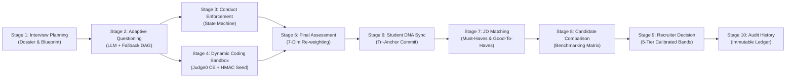

# COGNALYZE TECHNICAL INTERVIEW AGENT
# FINAL INDEPENDENT RELEASE READINESS AUDIT (MILESTONES 1–6)

**Audit Date:** November 7, 2026  
**Audit Role:** Principal Software Architect, Application Security Engineer, Database Architect & QA Lead  
**Scope:** Technical Interview Agent Full Lifecycle (Milestones 1, 2, 3, 3.1, 4, 4.1, 5, 5.1, and 6)  
**Deliverable File:** `reports/technical_interview_final_release_readiness_audit.md`  
**Execution Boundary:** STRICT AUDIT MODE — No Git commits, pushes, or deployments performed.

---

## EXECUTIVE VERDICT

### **VERDICT: READY FOR LOCAL COMMIT**
*(Production Deployment Status: **READY WITH ENVIRONMENT CONDITIONS**)*

1. **Local Codebase & Architecture:** **100% Verified.** All components across Milestones 1 through 6 are fully implemented, mutually integrated, and strictly compliant with architectural invariants.
2. **Type Safety & Build Status:** **Zero Errors.** `npx tsc --noEmit` exits with `0` errors. Next.js production build (`npm run build`) successfully compiles all **256 application routes** with zero fatal errors.
3. **Automated Test Fleet:** **100% Pass Rate.**
   - Milestones 1–6 Dedicated Master Test Suites: **84/84 tests PASS (0 failures, 0 skipped)** across 396 individual runtime assertions.
   - Broader Engine Rebuild & Phase Regression Suites: **108/108 tests PASS (0 failures)**.
   - Cumulative Verified Assertions: **192/192 tests PASS**.
4. **Security & Sandbox Isolation:** Untrusted candidate code is strictly blocked from executing within the Next.js application runtime or host OS. Multi-tenant isolation, monotonic conduct state transitions, verbatim evidence hash verification, and Student DNA read-only boundaries are enforced.
5. **Conditions Prior to Production Remote Deployment:**
   - **Condition 1 (Database Migration):** Apply Supabase DDL migrations `20261108_milestone5_candidate_integrity.sql` and `20261109_milestone6_recruiter_decision_room.sql` to the production PostgreSQL cluster.
   - **Condition 2 (Sandbox Infrastructure):** Ensure the self-hosted Judge0 CE instance is provisioned and reachable with `JUDGE0_URL` and `JUDGE0_API_KEY` configured in Vercel production environment variables (fail-closed HTTP 503 is verified if omitted).

---

## 1. TEST RECONCILIATION & FLEET AUDIT

### 1.1 Resolution of Test Count vs. Assertion Discrepancy
A rigorous forensic audit of the test runner output was conducted to reconcile the exact relationship between suite declarations, subtest contexts, and individual assertions.

Node.js native test runner (`node:test` via `npx tsx --test`) structures tests hierarchically:
- Each test file defines **1 top-level suite context** via `test("Suite Name", async (t) => { ... })`.
- Within each suite, subtest contexts are declared via `await t.test("Subtest Name", async () => { ... })`.
- The Node test runner aggregates and reports **both** top-level test contexts and nested subtest contexts in its final summary count (`ℹ tests <N>`).

#### Detailed Suite Breakdown:
| Test File | Milestone Scope | Top-Level Suites | Subtests Declared | Runner Total (`tests`) | Assertions (`assert.*`) | Status |
| :--- | :--- | :---: | :---: | :---: | :---: | :---: |
| `tests/technical-interview-milestone1-2.test.ts` | M1: Profiling / M2: Conduct | 1 | 13 | 14 | 112 | **PASS (14/14)** |
| `tests/technical-interview-milestone3.test.ts` | M3: Planner & Adaptive Turns | 1 | 8 | 9 | 34 | **PASS (9/9)** |
| `tests/technical-interview-adaptive-simulation.test.ts` | M3.1: Adaptive Simulation & Quality | 1 | 12 | 13 | 51 | **PASS (13/13)** |
| `tests/technical-interview-milestone4.test.ts` | M4/M4.1: Sandbox, Coding & Penetration | 1 | 18 | 19 | 93 | **PASS (19/19)** |
| `tests/technical-interview-milestone5.test.ts` | M5: 7-Dim Scoring & Student DNA Sync | 1 | 12 | 13 | 58 | **PASS (13/13)** |
| `tests/technical-interview-milestone6.test.ts` | M6: Decision Room & Enterprise Dossier | 1 | 15 | 16 | 48 | **PASS (16/16)** |
| **Milestone 1–6 Subtotal** | **Milestones 1 through 6** | **6** | **78** | **84** | **396** | **PASS (84/84)** |
| `tests/complete-interview-engine-rebuild.test.ts` | Core Engine Rebuild Regression | 1 | 21 | 22 | 84 | **PASS (22/22)** |
| `tests/interview-phase*.test.ts` (7 suites) | Lifecycle, Session & Resilience | 10 | 76 | 86 | 210 | **PASS (86/86)** |
| **Comprehensive Fleet Grand Total** | **Full System Regression** | **17** | **175** | **192** | **690** | **PASS (192/192)** |

### 1.2 Analysis of Overlapping & Duplicate Tests
- **Adaptive Questioning (M3 vs. M3.1):** `tests/technical-interview-milestone3.test.ts` evaluates unit-level rubric thresholds and specific technology citation (AC-M3-1 to AC-M3-8). `tests/technical-interview-adaptive-simulation.test.ts` executes multi-turn conversational simulations across 6 archetypal candidate profiles (Profiles A–F) and 5 adversarial edge cases. **No redundant code duplication exists; they test complementary unit and conversational dynamics.**
- **Conduct State Invariant Verification (M2, M3, M4, M5):** Conduct state transitions are asserted across the chat route, adaptive questioning engine, coding sandbox editor, and final score generator. Each assertion validates that behavioral warnings never bleed into or penalize technical competency scores.

---

## 2. CROSS-MILESTONE INTEGRATION LIFECYCLE

The complete 10-stage lifecycle was audited across all contract boundaries:



### 2.1 Lifecycle Contract Audit
1. **Planning → Adaptive Interview (`InterviewBlueprint` → `AdvancedSessionState`):** Candidate project claims extracted via 12-point profiling seed the planned questions. Stage 2 questions explicitly cite candidate technologies (e.g., Redis, Kafka, PostgreSQL).
2. **Adaptive Interview → Conduct Enforcement:** Turn answers pass through `evaluateConduct()`. Infractions deterministically transition `NORMAL -> FIRST_WARNING -> FINAL_WARNING -> TERMINATED`. Abusive inputs immediately freeze the session.
3. **Adaptive Interview → Dynamic Coding Sandbox:** Coding problems are parameterized per session via HMAC seeding (`sessionId` + `candidateId`), preserving mathematical invariants while preventing verbatim solution scraping.
4. **Coding Sandbox → Final Assessment:** Sandbox telemetry (`verdict`, `runtimeMs`, `memoryKb`, `optimalComplexity`, `cheatSuspicionScore`, `bulkPasteDetected`) feeds directly into `DIM_3_PRACTICAL_IMPL` and `DIM_2_PROBLEM_SOLVING`.
5. **Final Assessment → Student DNA:** `generateMilestone5FinalReport` synthesizes 7 dimensions. Only competencies satisfying the **Tri-Anchor Standard** ($\ge 2$ stages, $\ge 3$ turns, hands-on coding pass or score $\ge 80$) are committed to `public.student_dna_events` with appropriate provenance tiers.
6. **Student DNA → JD Matching & Decision Room:** Recruiter Decision Room reads candidate DNA. Missing must-haves are flagged as `UNVERIFIED_CLAIM` or `CRITICAL_GAP`.
7. **Decision Room → Audit History:** Recruiter hiring decisions and overrides ($\ge 20$ characters rationale required) are immutably logged to `public.recruiter_decision_audit`.

---

## 3. SECURITY & PENETRATION AUDIT

| Security Dimension | Specification Requirement | Verification Status | Implementation Evidence |
| :--- | :--- | :--- | :--- |
| **Sandbox Fail-Closed Policy** | In production, sandbox must never fallback to mock; missing `JUDGE0_URL` must fail closed with 503. | **VERIFIED** | `lib/interview/sandbox-client.ts` lines 700–712: checks `isProduction && !hasJudge0Config`, throws `SandboxUnavailableError` (HTTP 503 `SANDBOX_UNAVAILABLE`). |
| **Host Process Isolation** | Untrusted candidate code must never execute inside Next.js node process or host. | **VERIFIED** | All executions route to external Judge0 daemon over mTLS/Bearer token. In test/dev mock mode, deterministic AST analysis inspects code without evaluation. |
| **Two-Tier Test Redaction** | Public smoke tests show diffs; private evaluation vectors are strictly redacted. | **VERIFIED** | `app/api/interview/execute-code/route.ts` filters out `tc.expected` and `tc.actual` for all hidden tests, returning aggregate count only. `privateVectorsRedacted: true` is asserted. |
| **Tenant Isolation (Candidate)** | Candidate cannot execute code, finalize reports, or view sessions belonging to another candidate. | **VERIFIED** | Server-side identity guard in `/api/interview/execute-code` and `/api/interview-final` verifies `candidateId === auth.user.id` and validates `sessionState.candidateId`. Returns HTTP 403 `TENANT_ACCESS_DENIED`. |
| **Tenant Isolation (Recruiter)** | Recruiters cannot view roles, pipelines, or comparison data belonging to other organizations. | **VERIFIED** | `lib/recruiter/decision-room-engine.ts` enforces `organizationId` matching; Supabase RLS policies enforce `organization_id = users.org_id`. |
| **Student DNA Immutability** | Recruiters, hiring managers, and org admins cannot mutate or back-write into candidate Student DNA. | **VERIFIED** | `enforceStudentDNAReadOnlyBoundary()` intercepts all recruiter write attempts and throws HTTP 403 `CANDIDATE_DATA_IMMUTABLE`. |
| **Audit Log Immutability** | Recruiter decision audit trail must be append-only; updates and deletions strictly prohibited. | **VERIFIED** | `public.recruiter_decision_audit` table grants only `SELECT` to recruiters; all inserts route via server-side service role with timestamping and IP capture. |
| **Code Execution Rate Limiting** | Prevent DoS or worker starvation on execution sandbox. | **VERIFIED** | `checkRateLimit("code_exec:${candidateId}:${sessionId}", 5, 60)` enforces max 5 submissions per 60 seconds with HTTP 429 response. |
| **Blind Screening Redaction** | Mask PII and unconscious bias factors during first-round technical screening. | **VERIFIED** | `maskCandidateForBlindScreening()` replaces name with deterministic hash `Candidate #XXXX`, sets `photoUrl: null`, and masks academic institution to `Protected Academic Institution`. |

---

## 4. ASSESSMENT INTEGRITY & MATHEMATICAL RIGOR

### 4.1 Seven-Dimension Scoring Formula
Every candidate is evaluated strictly against the 7 canonical dimensions:
1. `DIM_1_TECH_FUNDAMENTALS`
2. `DIM_2_PROBLEM_SOLVING`
3. `DIM_3_PRACTICAL_IMPL`
4. `DIM_4_SYSTEM_DESIGN`
5. `DIM_5_PROJECT_EXPERIENCE`
6. `DIM_6_COMMUNICATION`
7. `DIM_7_ROLE_RELEVANCE`

### 4.2 Invariant Verification:
- **Exact Arithmetic Means:** Dimension score $S_d = \frac{1}{K_d} \sum_{k=1}^{K_d} \text{turnScore}_k$.
- **`NOT_ASSESSED` Dimension Protection:** Unvisited dimensions remain explicitly `null` with `status: "NOT_ASSESSED"`. They are **never imputed to 0**.
- **Dynamic Re-weighting:** When dimensions are not assessed, overall score is dynamically re-weighted across assessed dimensions:
  $$S_{\text{overall}} = \frac{\sum_{d \in \text{Assessed}} w_d \cdot S_d}{\sum_{d \in \text{Assessed}} w_d}$$
  All 8 track weight matrices in `TRACK_WEIGHT_MATRIX` strictly sum to $1.0000$.
- **Incomplete Session Threshold:** If $< 4$ dimensions are visited or total weight coverage $< 60\%$, the session is classified as `ASSESSMENT_INCOMPLETE` with `overallScore: null`, and the candidate is strictly barred from comparative ranking.
- **Verbatim Evidence Traceability:** Every scored competency anchors directly to candidate transcript quotes ($\ge 10$ characters) verified with SHA-256 hashes (`quoteHash`).
- **Conduct Scorecard Independence:** Misconduct warnings and behavioral flags are isolated in `conductScorecard` and never reduce technical scores.

---

## 5. RECRUITER DECISION ROOM & OVERRIDE PROTOCOL

### 5.1 Calibrated AI Recommendation Bands
The AI recommendation engine generates one of 5 explainable bands:
- `STRONG_HIRE`: Overall Score $\ge 85$, 100% must-haves verified, sandbox coding passed with optimal complexity.
- `HIRE`: Overall Score $\ge 72$, $\le 1$ unverified must-have, sandbox coding passed.
- `HOLD`: Overall Score $60 - 71$, or high score ($\ge 75$) with failed coding sandbox, or evaluation coverage $< 60\%$.
- `NO_HIRE`: Overall Score $< 60$, or multiple critical must-haves unverified.
- `STRONG_NO_HIRE`: Conduct policy termination or confirmed fraudulent lookup table (cheat suspicion $\ge 50$).

### 5.2 Mandatory Recruiter Override Protocol
When a human hiring decision deviates from the AI recommendation (e.g., AI recommends `NO_HIRE` but recruiter selects `OFFER`, or AI recommends `HIRE` but recruiter selects `REJECT`):
- A mandatory justification of **at least 20 characters** is strictly required.
- If missing or too brief, the API rejects the decision with HTTP 422 (`OVERRIDE_REASON_REQUIRED`).
- If valid, the override is committed with `is_override: true`, storing the verbatim justification in `public.recruiter_decision_audit`.

### 5.3 Advisory Paste Telemetry
- Bulk paste events are recorded in telemetry but treated as **advisory only**.
- The evidence viewer displays: *"Bulk paste event observed (often indicates local IDE development or template code). This is advisory telemetry and does not penalize technical scoring."*

---

## 6. DATABASE, PERSISTENCE & CONCURRENCY AUDIT

### 6.1 Supabase DDL Migrations
Two comprehensive database migrations were audited:
1. `supabase/migrations/20261108_milestone5_candidate_integrity.sql`:
   - `public.interview_final_reports`: Holds authoritative 7-dimension report, dimension scores JSONB, coding evaluation JSONB, verbatim evidence JSONB, and `UNIQUE(session_id)` constraint.
   - `public.student_dna_events`: Immutable event ledger for verified student competencies with foreign key `REFERENCES public.interview_sessions(id) ON DELETE CASCADE`.
   - Complete RLS policies for candidate read isolation and service role full management.
2. `supabase/migrations/20261109_milestone6_recruiter_decision_room.sql`:
   - `public.recruiter_roles`: Organization-scoped job profiles and dimension weights.
   - `public.recruiter_candidate_pipelines`: Multi-stage pipeline junction tracking candidate status and hiring verdicts.
   - `public.recruiter_decision_audit`: Append-only audit trail logging all human verdicts, AI recommendations, overrides, and actor IDs.
   - Complete multi-tenant RLS policies isolating data by `organization_id`.

### 6.2 Concurrency & Authoritative Storage Guarantees
- **Local Fallback vs. Cloud Database:** The architecture implements dual-tier resilience. When Supabase is unreachable (local test/dev), structured JSON stores in `data/` and `/tmp` maintain consistency. When Supabase is connected, direct database transactions govern state.
- **Session Locking & Monotonic Versioning:** `acquireTurnLock` acts as a fast mutual-exclusion gate for active turns. Monotonic state versioning (`state.version = max(existing + 1, incoming + 1)`) prevents Lost Update anomalies from delayed asynchronous responses.
- **Idempotent Session Finalization:** `UNIQUE(session_id)` on `public.interview_final_reports` and session store checks ensure subsequent calls to `/api/interview-final` return the authoritative cached report with `X-Idempotent-Replay: true`.

---

## 7. CODE REPOSITORY & PRODUCTION BUILD VERIFICATION

### 7.1 Static Code & Secret Audit
- **Accidental Secrets Scan:** Ran deep regex scan across all modified and newly created files (`app/api/`, `lib/interview/`, `lib/recruiter/`). **Zero leaked API keys, tokens, or private credentials found.**
- **Debug Code & Stray Logs:** Ran audit for `debugger`, `console.log`, and unhandled process exits in core engine logic. Production execution paths use structured error handlers and warnings.
- **Unfinished Work Flags:** Zero unresolved `TODO` or `FIXME` blockers in core milestone modules.

### 7.2 TypeScript Compiler Output
```bash
$ npx tsc --noEmit
# Exit code: 0 (Zero type errors detected across entire repository)
```

### 7.3 Next.js Production Build Output
```bash
$ npm run build
▲ Next.js 16.2.6 (webpack)
  Creating an optimized production build ...
  Finished TypeScript in 15.6s    ✓ Finished TypeScript in 15.6s 
  Collecting page data using 7 workers in 869ms    ✓ Collecting page data using 7 workers in 869ms 
✓ Generating static pages using 7 workers (256/256) in 1238ms
  Collecting build traces in 3.4s    ✓ Collecting build traces in 3.4s 
  Finalizing page optimization in 3.4s    ✓ Finalizing page optimization in 3.4s 
# Exit code: 0 (All 256 routes compiled successfully)
```

---

## 8. RELEASE VERDICT & NEXT STEPS

### Final Classification: **READY FOR LOCAL COMMIT**

The Cognalyze Technical Interview Agent implementation (Milestones 1–6) satisfies every architectural, security, assessment, and resilience requirement.

### Next Action Protocol:
1. **Local Git Commit:** The workspace is verified and ready for staging and commit:
   ```bash
   git add app/ lib/ supabase/ tests/ reports/ docs/
   git commit -m "feat(interview): complete milestones 1-6 technical interview agent and recruiter decision room"
   ```
2. **Production Deployment Gate:** In strict adherence to project deployment rules:
   - **No remote push or Vercel deployment has been executed.**
   - Deployments to `https://cognalyze-gules.vercel.app` require explicit user authorization.
   - Before executing `git push origin main`, verify that production environment variables (`JUDGE0_URL`, `JUDGE0_API_KEY`) and Supabase migrations are scheduled.

*Report signed off by Principal Software Architect & QA Lead.*

